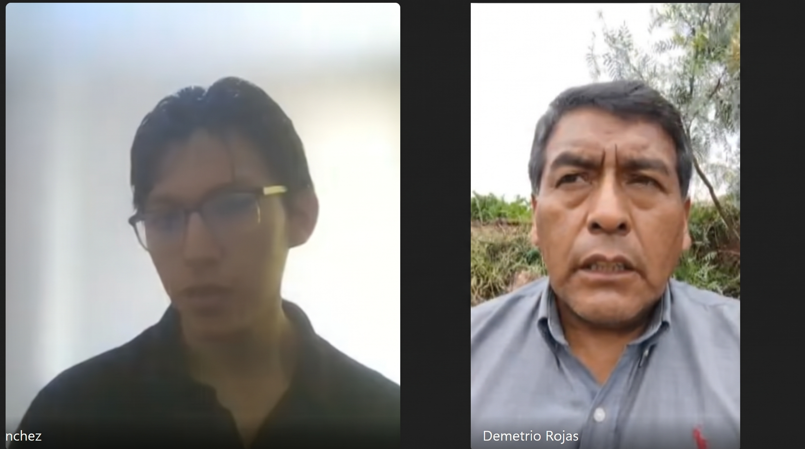

## 2.1 Entrevistas

### 2.1.1 Diseño de entrevistas

Para poder validar todo lo hablado en el capítulo I, se ha buscado realizar la entrevista a un dueño o administrador de una granja.

Para ello se ha desarrollado distintos bloques enfocados en distintos temas donde se plantearon las siguientes preguntas:

#### - Bloque 1: Contexto Operativo y Estructura del Negocio
- ¿Cómo está organizada físicamente la granja actualmente (hectáreas de cultivo, galpones de cuyes, pozas, establos, etc)?

- ¿Qué personal labora en el fundo y cómo se delegan o supervisan las tareas diarias (cuadernos, indicaciones verbales, WhatsApp)?

- ¿Cuáles son los principales cuellos de botella administrativos o pérdidas económicas que experimenta en el día a día?

#### - Bloque 2: Cultivos, Parcelas e Insumos Agrícolas
- ¿Cómo registran el stock y la aplicación de insumos (semillas, fertilizantes, pesticidas) por cada lote o parcela?

- ¿Existe una relación directa entre las cosechas de forraje y la alimentación del ganado/cuyes, o se maneja como un inventario independiente?

#### - Bloque 3: Crianza de Cuyes y Programa de Mejora Genética (Eje Central)
- ¿Cómo identifican individualmente o por lote a los reproductores y reproductores élite (aretes, muescas, tatuaje, placas en pozas)?

- ¿Qué líneas manejan (Perú, Andina, Inti, criollos)? ¿Cuentan hoy con historial escrito de padres/abuelos para evitar la consanguinidad?

- ¿Qué datos registran al momento de la parición (tamaño de camada, crías vivas/muertas, peso al destete)?

- ¿Bajo qué parámetros seleccionan a los cuyes destinados a pie de cría (mejora genética) frente a los destinados a beneficio/carne (ganancia diaria de peso, prolificidad, conformación)?

- ¿Cómo controlan las bajas (mortalidad), causas comunes y los tratamientos sanitarios preventivos o curativos?

#### - Bloque 4: Ganado Vacuno
- ¿Cuál es el propósito del hato vacuno (leche, carne, doble propósito)?

- ¿Qué eventos veterinarios requieren registrar de forma mandatoria (vacunas, desparasitaciones, control mastitis, inseminación/monta natural)?

#### - Bloque 5: Adopción Tecnológica y Requisitos No Funcionales (BD & App)
- ¿Los trabajadores que registran labores usan smartphones personales o se designará un dispositivo central?

- ¿Qué reporte o resumen le gustaría ver cada mañana para tomar decisiones antes de iniciar la jornada (alertas de empadre, stock bajo, costos de insumos)?

### 2.1.2 Registro de entrevistas

#### 2.1.2.1 Ficha Técnica de la Entrevista

- **Entrevistado:** Dueño / Administrador de la Granja D'Alejos.
- **Entrevistadores:** Equipo de AgroProyecciones.
- **Objetivo principal:** Levantar las reglas de negocio, entidades, atributos, flujos operativos y métricas críticas de la granja (ganado vacuno, cuyes, cultivos y mejora genética) para diseñar la base de datos relacional y validar las hipótesis del MVP.
- **Modalidad:** Virtual con grabación autorizada.
- **Link de Entrevista:** https://drive.google.com/file/d/1qtcShp3ZaVf1Kd2DCxAVF852t-Jcdkq-/view

#### 2.1.2.2. Estructura y Cronograma de la Sesión
|Fase|Duración|Objetivo|
|---|---|---|
|I. Introducción y Apertura|5 min|Encuadre del proyecto, agradecimiento y solicitud de consentimiento para grabar|
|II. Contexto General y Estructura del Fundo|10 min|Dimensionamiento de parcelas, corrales y personal.|
|III. Módulo Agrícola y Manejo de Insumos|10 min|Trazabilidad de siembra, fertilización, forraje y labores.|
|IV. Módulo Zootécnico: Cuyes y Mejora Genética|15 min|Identificación, líneas genéticas, empadres, consanguinidad y camadas.|
|V. Módulo Pecuario: Ganado Vacuno|8 min|Control de ganado, sanidad, pesaje y alimentación.|
|VI. Viabilidad Técnica, Usabilidad y Cierre|12 min|Dispositivos disponibles, conectividad, expectativas y acuerdos de MVP.|

### 2.1.3 Análisis de entrevistas

A partir de la entrevista realizada al segmento principal (empresarios agropecuarios y criadores), se identificaron patrones claros en relación con las necesidades, dificultades y expectativas frente a la gestión de sus fundos. La entrevista, realizada a Demetrio Rojas, gerente de una granja dedicada a la crianza de vacunos de doble propósito y cuyes con mejoramiento genético, reveló que las personas de este segmento gestionan sus operaciones combinando la agricultura (2 hectáreas de alfalfa en el caso del señor Rojas) con la ganadería, apoyándose en un equipo de trabajo reducido y con tareas calendarizadas.

En primer lugar, se evidenció que la principal dificultad operativa radica en la dependencia de registros manuales. El entrevistado manifestó que los datos sobre nacimientos, pesos, destetes, sexado y mortalidad se anotan en cuadernos y hojas físicas. Esta falta de digitalización genera una "ceguera administrativa", ya que el entrevistado indicó que la toma de decisiones, como cambios de raza o ajustes en la alimentación, se retrasa hasta por 15 o 30 días, tiempo en el que se comparan anotes manuales, lo que muchas veces resulta en pérdidas económicas o fracasos en los lotes de animales.

Asimismo, se identificó una marcada preocupación por el control zootécnico y genético. El entrevistado destacó la necesidad de rastrear eventos veterinarios (desparasitaciones, vitaminas, tratamientos para neumonía o salmonelosis) y, sobre todo, de evitar cruces no adecuados entre líneas o razas. Actualmente, identificar si un problema de natalidad o mortalidad de crías se debe al macho o a las hembras toma hasta un año de prueba y error. Frente a ello, se valoró la necesidad de contar con una herramienta que les permita verificar el parentesco y optimizar la conversión alimenticia en tiempo real.

Por otro lado, se detectaron limitaciones tecnológicas y de acceso a la información. El entrevistado señaló que, aunque existen experiencias internacionales de monitoreo con sensores, en el sector rural peruano la falta de herramientas digitales limita el crecimiento. Se enfatizó la necesidad de un aplicativo que no solo registre datos, sino que también brinde información oportuna sobre el comportamiento del mercado (precios de la carne, fenómenos climáticos) y alertas tempranas ante cambios bruscos de estación, los cuales incrementan la mortalidad en cuyes.

Desde la perspectiva del acceso operativo, se observó que la solución debe ser intuitiva, dado que el personal de campo (asistentes) es quien registrará los datos diarios. El entrevistado subrayó que la plataforma debe adaptarse a la rutina del fundo y permitir la consulta desde dispositivos móviles o computadoras, eliminando la necesidad de estar físicamente presente en los corrales para revisar el avance de la producción.

En cuanto al segmento secundario (asociaciones, cooperativas, criadores de cuyes y técnicos/veterinarios), no se cuenta aún con entrevistas registradas que permitan un sustento estadístico. Sin embargo, a partir de las hipótesis del proyecto, se proyecta que estos usuarios demandarán funcionalidades de centralización de información, historiales clínicos compartidos y herramientas para la comercialización de licencias, lo cual deberá validarse en futuras iteraciones.

Finalmente, se concluye que una solución para el sector agropecuario debe ser accesible, bilingüe o de lenguaje sencillo, adaptable a la baja conectividad y centrada en la trazabilidad en tiempo real. A partir de estos hallazgos, se define el siguiente arquetipo preliminar para el segmento principal: "El empresario agropecuario empírico", un gerente que posee fundos mixtos, trabaja con personal reducido, necesita digitalizar sus cuadernos de campo para evitar la consanguinidad, optimizar la alimentación y tomar decisiones basadas en datos para asegurar la rentabilidad de su negocio.
