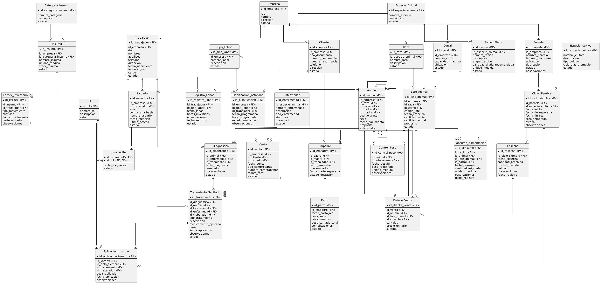

## 3.3. Enfoque Relacional
Se presentan las relaciones encontradas entre las tablas:

| Entidad 1 | Relación | Entidad 2 | Descripción |
|---|---|---|---|
| Empresa | 1:M | Usuario | Una empresa tiene muchos usuarios; cada usuario pertenece a una empresa |
| Trabajador | 1:M | Usuario | Un trabajador puede tener varios usuarios|
| Usuario | 1:M | Usuario_Rol | Un usuario puede tener varias asignaciones de rol |
| Rol | 1:M | Usuario_Rol | Un rol puede estar asignado a varios usuarios |
| Usuario | M:N | Rol | Un usuario puede tener varios roles y un rol varios usuarios; se resuelve con Usuario_Rol |
| Empresa | 1:M | Trabajador | Una empresa tiene muchos trabajadores; cada trabajador pertenece a una empresa |
| Empresa | 1:M | Tipo_Labor | Cada empresa define sus propios tipos de labor|
| Trabajador | 1:M | Registro_Labor | Un trabajador realiza muchos registros de labor |
| Tipo_Labor | 1:M | Registro_Labor | Un tipo de labor puede aparecer en muchos registros |
| Empresa | 1:M | Parcela | Una empresa tiene muchas parcelas |
| Parcela | 1:M | Ciclo_Siembra | Una parcela puede tener varios ciclos de siembra |
| Especie_Cultivo | 1:M | Ciclo_Siembra | Un cultivo puede sembrarse en muchos ciclos |
| Ciclo_Siembra | 1:M | Cosecha | Un ciclo de siembra puede generar varias cosechas |
| Especie_Animal | 1:M | Raza | Una especie tiene varias razas; cada raza pertenece a una especie |
| Empresa | 1:M | Corral | Una empresa tiene varios corrales |
| Empresa | 1:M | Animal | Una empresa posee muchos animales |
| Raza | 1:M | Animal | Una raza clasifica muchos animales |
| Corral | 1:M | Animal | Un corral alberga varios animales |
| Animal (padre) | 1:M | Animal (hijo) | Relación recursiva: un padre tiene muchas crías; cada animal tiene un padre o nulo |
| Animal (madre) | 1:M | Animal (hijo) | Relación recursiva: una madre tiene muchas crías; cada animal tiene una madre o nulo |
| Empresa | 1:M | Lote_Animal | Una empresa posee varios lotes de animales |
| Raza | 1:M | Lote_Animal | Un lote tiene una raza predominante; una raza puede estar en varios lotes|
| Corral | 1:M | Lote_Animal | Un corral puede alojar varios lotes |
| Animal | 1:M | Control_Peso | Un animal puede tener varios pesajes|
| Lote_Animal | 1:M | Control_Peso | Un lote puede tener varios pesajes |
| Animal (padre) | 1:M | Empadre | Un macho reproductor puede participar en varios empadres |
| Animal (madre) | 1:M | Empadre | Una hembra puede tener varios empadres |
| Trabajador | 1:M | Empadre | Un trabajador supervisa varios empadres. |
| Empadre | 1:1 | Parto | Lógicamente un empadre origina un parto |
| Especie_Animal | 1:M | Enfermedad | Una especie puede tener varias enfermedades catalogadas |
| Animal | 1:M | Diagnostico | Un animal puede tener varios diagnósticos |
| Enfermedad | 1:M | Diagnostico | Una enfermedad puede diagnosticarse en varios animales |
| Trabajador | 1:M | Diagnostico | Un trabajador realiza varios diagnósticos |
| Diagnostico | 1:M | Tratamiento_Sanitario | Un diagnóstico puede originar varios tratamientos |
| Animal | 1:M | Tratamiento_Sanitario | Un animal puede recibir varios tratamientos |
| Lote_Animal | 1:M | Tratamiento_Sanitario | Un lote puede recibir varios tratamientos |
| Enfermedad | 1:M | Tratamiento_Sanitario | Una enfermedad puede tratarse o prevenirse en varios tratamientos |
| Trabajador | 1:M | Tratamiento_Sanitario | Un trabajador aplica varios tratamientos |
| Especie_Animal | 1:M | Racion_Dieta | Una especie tiene varias raciones/dietas |
| Racion_Dieta | 1:M | Consumo_Alimentacion | Una ración se usa en muchos consumos |
| Animal | 1:M | Consumo_Alimentacion | Un animal puede tener varios consumos |
| Lote_Animal | 1:M | Consumo_Alimentacion | Un lote puede tener varios consumos |
| Corral (id_galpon) | 1:M | Consumo_Alimentacion | Un corral/galpón puede tener varios consumos |
| Empresa | 1:M | Insumo | Una empresa posee muchos insumos en inventario |
| Categoria_Insumo | 1:M | Insumo | Una categoría agrupa muchos insumos |
| Insumo | 1:M | Kardex_Inventario | Un insumo tiene muchos movimientos de kardex |
| Trabajador | 1:M | Kardex_Inventario | Un trabajador registra o autoriza varios movimientos |
| Kardex_Inventario | 1:M | Aplicacion_Insumo | Un movimiento de salida puede asociarse a aplicaciones |
| Ciclo_Siembra | 1:M | Aplicacion_Insumo | Un ciclo agrícola puede tener varias aplicaciones de insumos |
| Tratamiento_Sanitario | 1:M | Aplicacion_Insumo | Un tratamiento puede tener varias aplicaciones de insumos |
| Trabajador | 1:M | Aplicacion_Insumo | Un trabajador aplica varios insumos |
| Empresa | 1:M | Cliente | Una empresa registra muchos clientes |
| Empresa | 1:M | Venta | Una empresa realiza muchas ventas |
| Cliente | 1:M | Venta | Un cliente puede tener muchas ventas |
| Usuario | 1:M | Venta | Un usuario registra muchas ventas |
| Venta | 1:M | Detalle_Venta | Una venta tiene muchas líneas de detalle |
| Animal | 1:M | Detalle_Venta | Un animal puede aparecer en líneas de detalle |
| Lote_Animal | 1:M | Detalle_Venta | Un lote puede aparecer en líneas de detalle |
| Cosecha | 1:M | Detalle_Venta | Una cosecha puede aparecer en líneas de detalle.|
| Venta | M:N | Animal | Una venta puede incluir varios animales y un animal puede figurar en varias líneas/ventas; se resuelve con Detalle_Venta. |
| Venta | M:N | Lote_Animal | Una venta puede incluir varios lotes y un lote puede figurar en varias líneas/ventas; se resuelve con Detalle_Venta. |
| Venta | M:N | Cosecha | Una venta puede incluir varias cosechas y una cosecha puede figurar en varias líneas/ventas; se resuelve con Detalle_Venta. |
| Empresa | 1:M | Planificacion_Actividad | Una empresa programa muchas actividades |
| Tipo_Labor | 1:M | Planificacion_Actividad | Un tipo de labor se usa en muchas planificaciones |
| Trabajador | 1:M | Planificacion_Actividad | Un trabajador tiene muchas actividades programadas |

### 3.3.1. Diagrama Entidad-Relación Lógico

---
