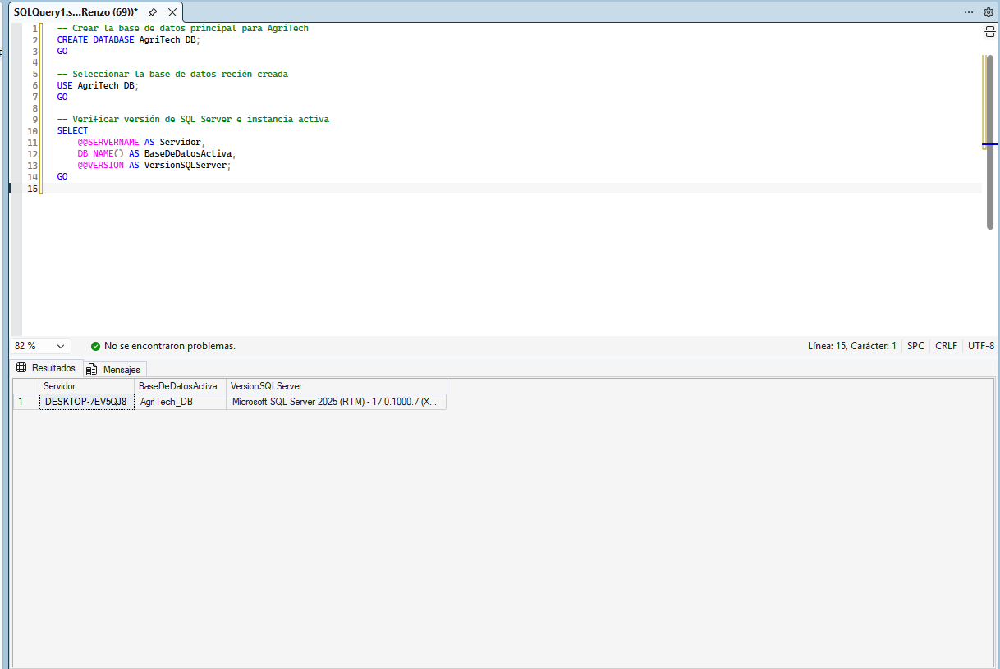

## 4.1. Sistema de gestión de base de datos
El Sistema de Gestión de Bases de Datos Relacional (RDBMS) constituye la plataforma tecnológica central para la persistencia transaccional y analítica del sistema AgriTech. Su función es centralizar la gestión operativa de los fundos agropecuarios, reemplazando la dependencia de anotaciones manuales en cuadernos por un repositorio relacional estructurado, íntegro y auditable.

El motor de base de datos asegura el cumplimiento riguroso de las propiedades ACID (Atomicidad, Consistencia, Aislamiento y Durabilidad), garantizando la integridad de datos entre las 32 entidades del dominio identificadas. Administra de forma consistente las transacciones de inventario en `Kardex_Inventario` y `Aplicacion_Insumo`, la asignación de tareas operativas (`Registro_Labor`, `Planificacion_Actividad`), la trazabilidad zootécnica y genealógica en `Animal`, `Empadre` y `Parto`, el control sanitario (`Diagnostico`, `Tratamiento_Sanitario`), y las transacciones comerciales en `Venta` y `Detalle_Venta`. Asimismo, provee el aislamiento necesario para soportar una arquitectura multiempresa (multi-tenant) a través de la entidad `Empresa`.

## 4.1.1. Evaluación y elección del sistema de gestión de base de datos relacional

### A. Criterios de Selección
Para la selección del motor de base de datos relacional entre las opciones autorizadas por la cátedra (SQL Server, MySQL y Oracle), se establecieron parámetros de evaluación acordes a los requisitos funcionales (RF) y no funcionales (RNF) de AgriTech:

1. **Integridad Referencial y Restricciones Complejas (RNF-02, RF-04, RF-05):** Capacidad de soportar claves foráneas recursivas en la tabla `Animal` (`id_padre` e `id_madre`), permitiendo construir árboles genealógicos y validar mediante restricciones, funciones de usuario o triggers que no se programen cruces con consanguinidad en `Empadre`.
2. **Rendimiento en Consultas Complejas y Reportes (RNF-01):** Alta eficiencia del optimizador de consultas para resolver agregaciones y uniones multicapa entre tablas operativas (`Parcela`, `Ciclo_Siembra`, `Cosecha`, `Consumo_Alimentacion`, `Venta`) con tiempos de respuesta en pantalla inferiores a 1 segundo.
3. **Soporte Multi-tenant y Seguridad Granular (RF-11, RNF-05, RNF-07):** Soporte nativo de Row-Level Security (RLS) y esquemas para segmentar y aislar los registros de cada cliente a partir de `Empresa`, garantizando que la arquitectura soporte el crecimiento de múltiples fundos sin degradar tiempos de respuesta más allá de 2 segundos.
4. **Manejo de Concurrencia y Respaldo Transaccional (RNF-06):** Motor transaccional de alto rendimiento que evite bloqueos entre la carga operativa diaria y la emisión de reportes, junto con utilidades automáticas de generación de copias de seguridad (.bak).
5. **Ecosistema y Herramientas del Curso:** Compatibilidad con herramientas de administración visuales (SSMS), soporte en Visual Studio Code mediante la extensión ERD Editor y alineación estricta con las tecnologías relacionales requeridas en la guía de la asignatura.

---

### B. Análisis Comparativo de Alternativas

| Criterio | Microsoft SQL Server | MySQL (Motor InnoDB) | Oracle Database |
| :--- | :--- | :--- | :--- |
| **Integración con Herramientas Académicas y Entorno** | Integración nativa con SQL Server Management Studio (SSMS), drivers directos en VS Code y soporte inmediato en la extensión ERD Editor. | Amplio soporte mediante MySQL Workbench y extensiones de VS Code; estándar en desarrollos web ligeros. | Requiere Oracle SQL Developer; instalación y configuración de clientes más pesada y compleja para entornos locales. |
| **Consultas Jerárquicas y Recursividad (Genealogía)** | Soporte óptimo y maduro para CTEs recursivas (`WITH`) y tipos especializados de jerarquía en dialecto T-SQL para cálculo de consanguinidad en `Animal`. | Soporte para CTEs a partir de la versión 8.0, pero con menor optimización y flexibilidad en recorridos recursivos profundos. | Soporte maduro para cláusulas jerárquicas nativas (`CONNECT BY / START WITH`) y CTEs recursivas con alto rendimiento. |
| **Aislamiento Multiempresa (Multi-tenancy)** | Soporte nativo y granular de Row-Level Security (RLS) mediante predicados de seguridad y esquemas de base de datos para aislar por `id_empresa`. | No cuenta con RLS nativo en su versión comunitaria; requiere control manual en cláusulas `WHERE` o particionado de bases de datos. | Soporte avanzado de Virtual Private Database (VPD) y RLS empresarial; curva de configuración más compleja. |
| **Integridad Transaccional y Rendimiento** | Excelente optimizador de costos para planes de ejecución, manejo transaccional robusto y aislamiento configurable mediante Snapshots. | Cumplimiento ACID confiable en InnoDB, pero optimizador con limitaciones en planes de ejecución de joins multicapa masivos. | Rendimiento empresarial líder en grandes volúmenes de datos transaccionales, requiriendo mayor asignación de memoria y CPU. |
| **Curva de Despliegue y Administración** | Rápida instalación y configuración local con SQL Server Express o Developer Edition; herramientas gráficas intuitivas para backups y monitoreo. | Muy ligera y de bajo consumo en entornos locales y contenedores. | Elevada complejidad de administración (gestión de instancias, tablespaces, listeners de red y licenciamiento restrictivo). |

---

### C. Justificación y Elección del SGBD
Tras evaluar las alternativas frente a los requerimientos de la plataforma **AgriTech** y los lineamientos tecnológicos del curso, el equipo seleccionó **Microsoft SQL Server** como el Sistema de Gestión de Bases de Datos Relacional, sustentado en las siguientes razones técnicas:

1. **Aislamiento Multi-tenant Nativo mediante Row-Level Security (RF-11):** SQL Server permite implementar políticas de seguridad a nivel de fila (RLS) usando funciones de predicado en T-SQL. Esto asegura que cada fundo asociado a la entidad `Empresa` visualice únicamente su información operativa, evitando fugas de datos entre clientes sin recargar la capa de aplicación.
2. **Capacidad de Análisis Jerárquico para Genealogía (RF-04, RF-05):** El soporte avanzado de CTEs recursivas en T-SQL permite recorrer eficientemente las relaciones de parentesco en la tabla `Animal` (ascendencia y descendencia a través de `id_padre` e `id_madre`), posibilitando la detección y bloqueo inmediato de cruces consanguíneos en `Empadre`.
3. **Consistencia Transaccional e Integridad Referencial (RNF-02, RNF-06):** Brinda un control estricto en transacciones complejas que comprometen inventario (`Kardex_Inventario`), aplicaciones de campo (`Aplicacion_Insumo`) y ventas (`Venta`, `Detalle_Venta`), ofreciendo mecanismos sencillos y programables para respaldos automáticos periódicos.
4. **Compatibilidad Plena con las Tecnologías del Proyecto:** Facilita la generación, validación y ejecución de scripts DDL/DML directamente desde **ERD Editor** en Visual Studio Code y su posterior administración y monitoreo visual en **SQL Server Management Studio (SSMS)**.

---

### D. Evidencia de Implementación del SGBD
A continuación, se presenta la evidencia de la instancia de base de datos relacional creada y conectada en **Microsoft SQL Server**:

