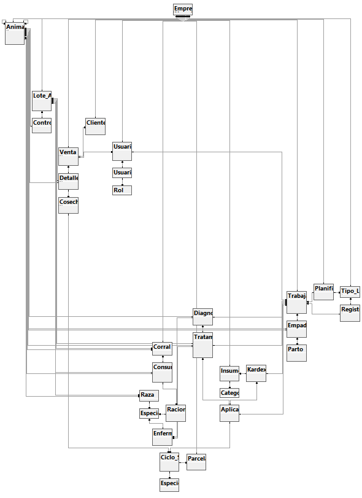

## 4.2. Diagramas de datos

En esta sección se detalla la materialización física de la arquitectura de datos relacional de **AgriTech** implementada en **Microsoft SQL Server (T-SQL)** para las 32 entidades transaccionales del dominio agropecuario.

---

## 4.2.1. Diagrama entidad-relación físico

### A. Mapeo del Modelo Lógico al Modelo Físico (Microsoft SQL Server)

Para trasladar el diseño lógico del Capítulo 3 al motor **Microsoft SQL Server**, se aplicaron las siguientes convenciones físicas y mapeos de tipos de datos:

| Tipo Lógico (Cap. 3) | Tipo Físico (T-SQL) | Justificación Técnica en SQL Server |
| :--- | :--- | :--- |
| `INT` (PK subrogada) | `INT IDENTITY(1,1)` | Generación autoincremental determinística para claves primarias subrogadas. |
| `BOOLEAN` | `BIT` | Tipo nativo booleano de SQL Server (`0` = inactivo/falso, `1` = activo/verdadero), acompañado de `DEFAULT 1`. |
| `TIMESTAMP` | `DATETIME2(0)` | En SQL Server, `TIMESTAMP` es sinónimo obsoleto de `ROWVERSION` (binario); `DATETIME2(0)` provee fecha y hora exacta al segundo con `DEFAULT SYSDATETIME()`. |
| `TEXT` | `VARCHAR(MAX)` | Reemplaza el tipo obsoleto `TEXT` en SQL Server manteniendo compatibilidad con funciones de cadena e indexación. |
| `VARCHAR(n)` / `CHAR(n)` | `VARCHAR(n)` / `CHAR(n)` | Longitud acotada exacta según las reglas de negocio (ej. `CHAR(8)` para DNI, `VARCHAR(11)` para RUC). |
| `DECIMAL(p,s)` | `DECIMAL(p,s)` | Precisión fija para montos financieros, pesos, hectáreas y dosis, evitando errores de coma flotante. |
| Integridad Referencial | `ON DELETE NO ACTION` | Previene el error 1785 (*multiple cascade paths*) propio de SQL Server en grafos con múltiples rutas hacia `Empresa`, priorizando el borrado lógico (`estado = 0`). |

---

### B. Especificación Detallada del Modelo Físico (32 Tablas)

#### Módulo 1: Seguridad, Accesos y Multiempresa

| Tabla | Columna | Tipo Físico | Clave | Restricciones (`NOT NULL`, `UNIQUE`, `CHECK`, `DEFAULT`) |
| :--- | :--- | :--- | :--- | :--- |
| **Empresa** | `id_empresa` | `INT IDENTITY(1,1)` | `PK` | `NOT NULL` |
| | `ruc` | `CHAR(11)` | `UQ` | `NOT NULL`, `UQ_Empresa_Ruc`, `CHECK (LEN(ruc) = 11 AND ruc NOT LIKE '%[^0-9]%')` |
| | `nombre` | `VARCHAR(150)` | `UQ` | `NOT NULL`, `UQ_Empresa_Nombre` |
| | `direccion` | `VARCHAR(200)` | | `NOT NULL` |
| | `estado` | `BIT` | | `NOT NULL`, `DEFAULT 1` |
| **Trabajador** | `id_trabajador` | `INT IDENTITY(1,1)` | `PK` | `NOT NULL` |
| | `id_empresa` | `INT` | `FK`, `UQ` | `NOT NULL`, `FK -> Empresa(id_empresa)`, parte de `UQ_Trabajador_Empresa_Dni` |
| | `dni` | `CHAR(8)` | `UQ` | `NOT NULL`, `UQ_Trabajador_Empresa_Dni (id_empresa, dni)`, `CHECK (LEN(dni) = 8 AND dni NOT LIKE '%[^0-9]%')` |
| | `nombres` | `VARCHAR(100)` | | `NOT NULL` |
| | `apellidos` | `VARCHAR(100)` | | `NOT NULL` |
| | `telefono` | `VARCHAR(20)` | | `NULL` |
| | `direccion` | `VARCHAR(200)` | | `NULL` |
| | `fecha_nacimiento` | `DATE` | | `NOT NULL` |
| | `fecha_ingreso` | `DATE` | | `NOT NULL`, `DEFAULT CAST(GETDATE() AS DATE)`, `CHECK (fecha_ingreso >= fecha_nacimiento)` |
| | `cargo` | `VARCHAR(100)` | | `NOT NULL` |
| | `estado` | `BIT` | | `NOT NULL`, `DEFAULT 1` |
| **Rol** | `id_rol` | `INT IDENTITY(1,1)` | `PK` | `NOT NULL` |
| | `nombre_rol` | `VARCHAR(50)` | `UQ` | `NOT NULL`, `UQ_Rol_NombreRol` |
| | `descripcion` | `VARCHAR(MAX)` | | `NULL` |
| | `estado` | `BIT` | | `NOT NULL`, `DEFAULT 1` |
| **Usuario** | `id_usuario` | `INT IDENTITY(1,1)` | `PK` | `NOT NULL` |
| | `id_empresa` | `INT` | `FK`, `UQ` | `NOT NULL`, `FK -> Empresa(id_empresa)`, parte de `UQ_Usuario_Empresa_NombreUsuario` |
| | `id_trabajador` | `INT` | `FK` | `NULL`, `FK -> Trabajador(id_trabajador)` |
| | `email` | `VARCHAR(150)` | `UQ` | `NOT NULL`, `UQ_Usuario_Email`, `CHECK (email LIKE '%_@__%.__%')` |
| | `contrasena_hash` | `VARCHAR(255)` | | `NOT NULL` |
| | `nombre_usuario` | `VARCHAR(100)` | `UQ` | `NOT NULL`, `UQ_Usuario_Empresa_NombreUsuario (id_empresa, nombre_usuario)` |
| | `fecha_creacion` | `DATETIME2(0)` | | `NOT NULL`, `DEFAULT SYSDATETIME()` |
| | `ultimo_acceso` | `DATETIME2(0)` | | `NULL` |
| | `estado` | `BIT` | | `NOT NULL`, `DEFAULT 1` |
| **Usuario_Rol** | `id_usuario` | `INT` | `PK`, `FK` | `NOT NULL`, `FK -> Usuario(id_usuario)` |
| | `id_rol` | `INT` | `PK`, `FK` | `NOT NULL`, `FK -> Rol(id_rol)` |
| | `fecha_asignacion` | `DATETIME2(0)` | | `NOT NULL`, `DEFAULT SYSDATETIME()` |
| | `estado` | `BIT` | | `NOT NULL`, `DEFAULT 1` |

#### Módulo 2: Gestión Laboral y Planificación

| Tabla | Columna | Tipo Físico | Clave | Restricciones (`NOT NULL`, `UNIQUE`, `CHECK`, `DEFAULT`) |
| :--- | :--- | :--- | :--- | :--- |
| **Tipo_Labor** | `id_tipo_labor` | `INT IDENTITY(1,1)` | `PK` | `NOT NULL` |
| | `id_empresa` | `INT` | `FK`, `UQ` | `NOT NULL`, `FK -> Empresa(id_empresa)`, parte de `UQ_TipoLabor_Empresa_Nombre` |
| | `nombre_labor` | `VARCHAR(100)` | `UQ` | `NOT NULL`, `UQ_TipoLabor_Empresa_Nombre (id_empresa, nombre_labor)` |
| | `descripcion` | `VARCHAR(MAX)` | | `NULL` |
| | `estado` | `BIT` | | `NOT NULL`, `DEFAULT 1` |
| **Registro_Labor** | `id_registro_labor` | `INT IDENTITY(1,1)` | `PK` | `NOT NULL` |
| | `id_trabajador` | `INT` | `FK` | `NOT NULL`, `FK -> Trabajador(id_trabajador)` |
| | `id_tipo_labor` | `INT` | `FK` | `NOT NULL`, `FK -> Tipo_Labor(id_tipo_labor)` |
| | `fecha_labor` | `DATE` | | `NOT NULL`, `DEFAULT CAST(GETDATE() AS DATE)` |
| | `horas_invertidas` | `DECIMAL(5,2)` | | `NOT NULL`, `CHECK (horas_invertidas > 0 AND horas_invertidas <= 24)` |
| | `observaciones` | `VARCHAR(MAX)` | | `NULL` |
| | `fecha_registro` | `DATETIME2(0)` | | `NOT NULL`, `DEFAULT SYSDATETIME()` |
| | `estado` | `BIT` | | `NOT NULL`, `DEFAULT 1` |
| **Planificacion_Actividad** | `id_planificacion` | `INT IDENTITY(1,1)` | `PK` | `NOT NULL` |
| | `id_empresa` | `INT` | `FK`, `UQ` | `NOT NULL`, `FK -> Empresa(id_empresa)` |
| | `id_tipo_labor` | `INT` | `FK` | `NOT NULL`, `FK -> Tipo_Labor(id_tipo_labor)` |
| | `id_trabajador` | `INT` | `FK`, `UQ` | `NOT NULL`, `FK -> Trabajador(id_trabajador)` |
| | `fecha_programada` | `DATE` | `UQ` | `NOT NULL`, parte de `UQ_Planificacion_Trabajador_Horario` |
| | `hora_programada` | `TIME(0)` | `UQ` | `NOT NULL`, `UQ_Planificacion_Trabajador_Horario (id_empresa, id_trabajador, fecha_programada, hora_programada)` |
| | `estado_ejecucion` | `VARCHAR(50)` | | `NOT NULL`, `DEFAULT 'Pendiente'`, `CHECK (estado_ejecucion IN ('Pendiente','En Progreso','Completada','Vencida'))` |
| | `observaciones` | `VARCHAR(MAX)` | | `NULL` |

#### Módulo 3: Gestión Agrícola

| Tabla | Columna | Tipo Físico | Clave | Restricciones (`NOT NULL`, `UNIQUE`, `CHECK`, `DEFAULT`) |
| :--- | :--- | :--- | :--- | :--- |
| **Parcela** | `id_parcela` | `INT IDENTITY(1,1)` | `PK` | `NOT NULL` |
| | `id_empresa` | `INT` | `FK`, `UQ` | `NOT NULL`, `FK -> Empresa(id_empresa)` |
| | `nombre_parcela` | `VARCHAR(100)` | `UQ` | `NOT NULL`, `UQ_Parcela_Empresa_Nombre (id_empresa, nombre_parcela)` |
| | `tamano_hectareas` | `DECIMAL(10,2)` | | `NOT NULL`, `CHECK (tamano_hectareas > 0)` |
| | `ubicacion` | `VARCHAR(200)` | | `NULL` |
| | `tipo_suelo` | `VARCHAR(100)` | | `NULL` |
| | `estado` | `VARCHAR(20)` | | `NOT NULL`, `DEFAULT 'Disponible'`, `CHECK (estado IN ('Disponible','En uso','Inactiva'))` |
| | `observaciones` | `VARCHAR(MAX)` | | `NULL` |
| **Especie_Cultivo** | `id_especie_cultivo` | `INT IDENTITY(1,1)` | `PK` | `NOT NULL` |
| | `nombre_cultivo` | `VARCHAR(100)` | `UQ` | `NOT NULL`, `UQ_EspecieCultivo_Nombre` |
| | `descripcion` | `VARCHAR(MAX)` | | `NULL` |
| | `tipo_cultivo` | `VARCHAR(50)` | | `NOT NULL` |
| | `ciclo_dias_promedio` | `INT` | | `NOT NULL`, `CHECK (ciclo_dias_promedio > 0)` |
| | `estado` | `BIT` | | `NOT NULL`, `DEFAULT 1` |
| **Ciclo_Siembra** | `id_ciclo_siembra` | `INT IDENTITY(1,1)` | `PK` | `NOT NULL` |
| | `id_parcela` | `INT` | `FK`, `UQ` | `NOT NULL`, `FK -> Parcela(id_parcela)` |
| | `id_especie_cultivo` | `INT` | `FK`, `UQ` | `NOT NULL`, `FK -> Especie_Cultivo(id_especie_cultivo)` |
| | `fecha_inicio` | `DATE` | `UQ` | `NOT NULL`, `UQ_CicloSiembra_Parcela_Cultivo_Inicio (id_parcela, id_especie_cultivo, fecha_inicio)` |
| | `fecha_fin_esperada` | `DATE` | | `NOT NULL`, `CHECK (fecha_fin_esperada >= fecha_inicio)` |
| | `fecha_fin_real` | `DATE` | | `NULL`, `CHECK (fecha_fin_real IS NULL OR fecha_fin_real >= fecha_inicio)` |
| | `area_sembrada` | `DECIMAL(10,2)` | | `NOT NULL`, `CHECK (area_sembrada > 0)` |
| | `estado` | `VARCHAR(20)` | | `NOT NULL`, `DEFAULT 'En curso'`, `CHECK (estado IN ('En curso','Finalizado','Cancelado'))` |
| | `observaciones` | `VARCHAR(MAX)` | | `NULL` |
| **Cosecha** | `id_cosecha` | `INT IDENTITY(1,1)` | `PK` | `NOT NULL` |
| | `id_ciclo_siembra` | `INT` | `FK` | `NOT NULL`, `FK -> Ciclo_Siembra(id_ciclo_siembra)` |
| | `fecha_cosecha` | `DATE` | | `NOT NULL`, `DEFAULT CAST(GETDATE() AS DATE)` |
| | `cantidad_obtenida` | `DECIMAL(12,2)` | | `NOT NULL`, `CHECK (cantidad_obtenida > 0)` |
| | `unidad_medida` | `VARCHAR(20)` | | `NOT NULL`, `DEFAULT 'kg'` |
| | `calidad` | `VARCHAR(50)` | | `NOT NULL`, `DEFAULT 'Primera'` |
| | `observaciones` | `VARCHAR(MAX)` | | `NULL` |
| | `fecha_registro` | `DATETIME2(0)` | | `NOT NULL`, `DEFAULT SYSDATETIME()` |

#### Módulo 4: Gestión Ganadera, Genealogía y Reproducción

| Tabla | Columna | Tipo Físico | Clave | Restricciones (`NOT NULL`, `UNIQUE`, `CHECK`, `DEFAULT`) |
| :--- | :--- | :--- | :--- | :--- |
| **Especie_Animal** | `id_especie_animal` | `INT IDENTITY(1,1)` | `PK` | `NOT NULL` |
| | `nombre_especie` | `VARCHAR(100)` | `UQ` | `NOT NULL`, `UQ_EspecieAnimal_Nombre` |
| | `descripcion` | `VARCHAR(MAX)` | | `NULL` |
| | `estado` | `BIT` | | `NOT NULL`, `DEFAULT 1` |
| **Raza** | `id_raza` | `INT IDENTITY(1,1)` | `PK` | `NOT NULL` |
| | `id_especie_animal` | `INT` | `FK`, `UQ` | `NOT NULL`, `FK -> Especie_Animal(id_especie_animal)` |
| | `nombre_raza` | `VARCHAR(100)` | `UQ` | `NOT NULL`, `UQ_Raza_Especie_Nombre (id_especie_animal, nombre_raza)` |
| | `descripcion` | `VARCHAR(MAX)` | | `NULL` |
| | `estado` | `BIT` | | `NOT NULL`, `DEFAULT 1` |
| **Corral** | `id_corral` | `INT IDENTITY(1,1)` | `PK` | `NOT NULL` |
| | `id_empresa` | `INT` | `FK`, `UQ` | `NOT NULL`, `FK -> Empresa(id_empresa)` |
| | `nombre_corral` | `VARCHAR(100)` | `UQ` | `NOT NULL`, `UQ_Corral_Empresa_Nombre (id_empresa, nombre_corral)` |
| | `capacidad_maxima` | `INT` | | `NOT NULL`, `CHECK (capacidad_maxima > 0)` |
| | `ubicacion` | `VARCHAR(200)` | | `NULL` |
| | `estado` | `VARCHAR(50)` | | `NOT NULL`, `DEFAULT 'En uso'`, `CHECK (estado IN ('En uso','Mantenimiento','Inactivo'))` |
| **Animal** | `id_animal` | `INT IDENTITY(1,1)` | `PK` | `NOT NULL` |
| | `id_empresa` | `INT` | `FK`, `UQ` | `NOT NULL`, `FK -> Empresa(id_empresa)` |
| | `id_raza` | `INT` | `FK` | `NOT NULL`, `FK -> Raza(id_raza)` |
| | `id_corral` | `INT` | `FK` | `NOT NULL`, `FK -> Corral(id_corral)` |
| | `id_padre` | `INT` | `FK` | `NULL`, `FK -> Animal(id_animal)` (recursiva), `CHECK (id_padre IS NULL OR id_padre <> id_animal)` |
| | `id_madre` | `INT` | `FK` | `NULL`, `FK -> Animal(id_animal)` (recursiva), `CHECK (id_madre IS NULL OR id_madre <> id_animal)`, `CHECK (id_padre IS NULL OR id_madre IS NULL OR id_padre <> id_madre)` |
| | `codigo_arete` | `VARCHAR(50)` | `UQ` | `NOT NULL`, `UQ_Animal_Empresa_CodigoArete (id_empresa, codigo_arete)` |
| | `sexo` | `CHAR(1)` | | `NOT NULL`, `CHECK (sexo IN ('M','F'))` |
| | `fecha_nacimiento` | `DATE` | | `NOT NULL` |
| | `proposito` | `VARCHAR(50)` | | `NOT NULL`, `CHECK (proposito IN ('Carne','Leche','Pie de cría','Doble propósito'))` |
| | `estado_vital` | `VARCHAR(50)` | | `NOT NULL`, `DEFAULT 'Vivo'`, `CHECK (estado_vital IN ('Vivo','Muerto','Vendido'))` |
| **Lote_Animal** | `id_lote_animal` | `INT IDENTITY(1,1)` | `PK` | `NOT NULL` |
| | `id_empresa` | `INT` | `FK`, `UQ` | `NOT NULL`, `FK -> Empresa(id_empresa)` |
| | `id_raza` | `INT` | `FK` | `NOT NULL`, `FK -> Raza(id_raza)` |
| | `id_corral` | `INT` | `FK` | `NOT NULL`, `FK -> Corral(id_corral)` |
| | `codigo_lote` | `VARCHAR(100)` | `UQ` | `NOT NULL`, `UQ_LoteAnimal_Empresa_Codigo (id_empresa, codigo_lote)` |
| | `fecha_creacion` | `DATE` | | `NOT NULL`, `DEFAULT CAST(GETDATE() AS DATE)` |
| | `cantidad_inicial` | `INT` | | `NOT NULL`, `CHECK (cantidad_inicial > 0)` |
| | `cantidad_actual` | `INT` | | `NOT NULL`, `CHECK (cantidad_actual >= 0 AND cantidad_actual <= cantidad_inicial)` |
| | `proposito` | `VARCHAR(50)` | | `NOT NULL` |
| | `estado` | `BIT` | | `NOT NULL`, `DEFAULT 1` |
| **Control_Peso** | `id_control_peso` | `INT IDENTITY(1,1)` | `PK` | `NOT NULL` |
| | `id_animal` | `INT` | `FK`, `UQ*` | `NULL`, `FK -> Animal(id_animal)`, índice único filtrado `(id_animal, fecha_pesaje) WHERE id_animal IS NOT NULL` |
| | `id_lote_animal` | `INT` | `FK`, `UQ*` | `NULL`, `FK -> Lote_Animal(id_lote_animal)`, índice único filtrado `(id_lote_animal, fecha_pesaje) WHERE id_lote_animal IS NOT NULL` |
| | `fecha_pesaje` | `DATE` | `UQ*` | `NOT NULL`, `DEFAULT CAST(GETDATE() AS DATE)` |
| | `peso_registrado` | `DECIMAL(10,2)` | | `NOT NULL`, `CHECK (peso_registrado > 0)` |
| | `unidad_medida` | `VARCHAR(20)` | | `NOT NULL`, `DEFAULT 'kg'`, `CHECK (unidad_medida IN ('kg','g'))` |
| | `observaciones` | `VARCHAR(MAX)` | | `NULL`. Regla XOR tabla: `(id_animal IS NOT NULL AND id_lote_animal IS NULL) OR (id_animal IS NULL AND id_lote_animal IS NOT NULL)` |
| **Empadre** | `id_empadre` | `INT IDENTITY(1,1)` | `PK` | `NOT NULL` |
| | `id_padre` | `INT` | `FK`, `UQ` | `NOT NULL`, `FK -> Animal(id_animal)`, `CHECK (id_padre <> id_madre)` |
| | `id_madre` | `INT` | `FK`, `UQ` | `NOT NULL`, `FK -> Animal(id_animal)` |
| | `id_trabajador` | `INT` | `FK` | `NOT NULL`, `FK -> Trabajador(id_trabajador)` |
| | `fecha_empadre` | `DATE` | `UQ` | `NOT NULL`, `UQ_Empadre_Padre_Madre_Fecha (id_padre, id_madre, fecha_empadre)` |
| | `tipo_empadre` | `VARCHAR(50)` | | `NOT NULL`, `DEFAULT 'Monta natural'`, `CHECK (tipo_empadre IN ('Monta natural','Inseminación artificial','Transferencia embrionaria'))` |
| | `fecha_parto_esperada` | `DATE` | | `NOT NULL`, `CHECK (fecha_parto_esperada > fecha_empadre)` |
| | `estado_gestacion` | `VARCHAR(50)` | | `NOT NULL`, `DEFAULT 'Pendiente'`, `CHECK (estado_gestacion IN ('Confirmada','Fallida','Pendiente'))` |
| **Parto** | `id_parto` | `INT IDENTITY(1,1)` | `PK` | `NOT NULL` |
| | `id_empadre` | `INT` | `FK`, `UQ` | `NOT NULL`, `FK -> Empadre(id_empadre)`, `UQ_Parto_Empadre` (garantiza relación `1:1`) |
| | `fecha_parto_real` | `DATE` | | `NOT NULL` |
| | `crias_vivas` | `INT` | | `NOT NULL`, `DEFAULT 0`, `CHECK (crias_vivas >= 0)` |
| | `crias_muertas` | `INT` | | `NOT NULL`, `DEFAULT 0`, `CHECK (crias_muertas >= 0)`, `CHECK (crias_vivas + crias_muertas > 0)` |
| | `peso_camada_total` | `DECIMAL(10,2)` | | `NOT NULL`, `CHECK (peso_camada_total >= 0)` |
| | `complicaciones` | `VARCHAR(MAX)` | | `NULL` |
| | `estado` | `BIT` | | `NOT NULL`, `DEFAULT 1` |

#### Módulo 5: Sanidad y Alimentación

| Tabla | Columna | Tipo Físico | Clave | Restricciones (`NOT NULL`, `UNIQUE`, `CHECK`, `DEFAULT`) |
| :--- | :--- | :--- | :--- | :--- |
| **Enfermedad** | `id_enfermedad` | `INT IDENTITY(1,1)` | `PK` | `NOT NULL` |
| | `id_especie_animal` | `INT` | `FK`, `UQ` | `NOT NULL`, `FK -> Especie_Animal(id_especie_animal)` |
| | `nombre_enfermedad` | `VARCHAR(100)` | `UQ` | `NOT NULL`, `UQ_Enfermedad_Especie_Nombre (id_especie_animal, nombre_enfermedad)` |
| | `descripcion` | `VARCHAR(MAX)` | | `NULL` |
| | `tipo_enfermedad` | `VARCHAR(50)` | | `NOT NULL`, `CHECK (tipo_enfermedad IN ('Viral','Bacteriana','Parasitaria','Metabólica','Fúngica'))` |
| | `sintomas` | `VARCHAR(MAX)` | | `NULL` |
| | `gravedad` | `VARCHAR(20)` | | `NOT NULL`, `CHECK (gravedad IN ('Leve','Moderada','Grave'))` |
| | `estado` | `BIT` | | `NOT NULL`, `DEFAULT 1` |
| **Diagnostico** | `id_diagnostico` | `INT IDENTITY(1,1)` | `PK` | `NOT NULL` |
| | `id_animal` | `INT` | `FK` | `NOT NULL`, `FK -> Animal(id_animal)` |
| | `id_enfermedad` | `INT` | `FK` | `NOT NULL`, `FK -> Enfermedad(id_enfermedad)` |
| | `id_trabajador` | `INT` | `FK` | `NOT NULL`, `FK -> Trabajador(id_trabajador)` |
| | `fecha_diagnostico` | `DATETIME2(0)` | | `NOT NULL`, `DEFAULT SYSDATETIME()` |
| | `resultado` | `VARCHAR(20)` | | `NOT NULL`, `CHECK (resultado IN ('Positivo','Negativo','Sospechoso'))` |
| | `observaciones` | `VARCHAR(MAX)` | | `NULL` |
| | `estado` | `BIT` | | `NOT NULL`, `DEFAULT 1` |
| **Tratamiento_Sanitario** | `id_tratamiento` | `INT IDENTITY(1,1)` | `PK` | `NOT NULL` |
| | `id_diagnostico` | `INT` | `FK` | `NULL`, `FK -> Diagnostico(id_diagnostico)` |
| | `id_animal` | `INT` | `FK` | `NULL`, `FK -> Animal(id_animal)` |
| | `id_lote_animal` | `INT` | `FK` | `NULL`, `FK -> Lote_Animal(id_lote_animal)` |
| | `id_enfermedad` | `INT` | `FK` | `NOT NULL`, `FK -> Enfermedad(id_enfermedad)` |
| | `id_trabajador` | `INT` | `FK` | `NOT NULL`, `FK -> Trabajador(id_trabajador)` |
| | `tipo_tratamiento` | `VARCHAR(50)` | | `NOT NULL` |
| | `descripcion` | `VARCHAR(MAX)` | | `NULL` |
| | `medicamento_aplicado` | `VARCHAR(150)` | | `NOT NULL` |
| | `dosis` | `VARCHAR(50)` | | `NOT NULL` |
| | `fecha_aplicacion` | `DATETIME2(0)` | | `NOT NULL`, `DEFAULT SYSDATETIME()` |
| | `observaciones` | `VARCHAR(MAX)` | | `NULL` |
| | `estado` | `BIT` | | `NOT NULL`, `DEFAULT 1`. Regla XOR tabla: `(id_animal IS NOT NULL AND id_lote_animal IS NULL) OR (id_animal IS NULL AND id_lote_animal IS NOT NULL)` |
| **Racion_Dieta** | `id_racion` | `INT IDENTITY(1,1)` | `PK` | `NOT NULL` |
| | `id_especie_animal` | `INT` | `FK`, `UQ` | `NOT NULL`, `FK -> Especie_Animal(id_especie_animal)` |
| | `nombre_racion` | `VARCHAR(100)` | `UQ` | `NOT NULL`, `UQ_RacionDieta_Especie_Nombre (id_especie_animal, nombre_racion)` |
| | `descripcion` | `VARCHAR(MAX)` | | `NULL` |
| | `etapa_destino` | `VARCHAR(50)` | | `NOT NULL` |
| | `cantidad_diaria_recomendada` | `DECIMAL(10,2)` | | `NOT NULL`, `CHECK (cantidad_diaria_recomendada > 0)` |
| | `unidad_medida` | `VARCHAR(20)` | | `NOT NULL`, `DEFAULT 'kg'`, `CHECK (unidad_medida IN ('kg','g'))` |
| | `estado` | `BIT` | | `NOT NULL`, `DEFAULT 1` |
| **Consumo_Alimentacion** | `id_consumo` | `INT IDENTITY(1,1)` | `PK` | `NOT NULL` |
| | `id_racion` | `INT` | `FK` | `NOT NULL`, `FK -> Racion_Dieta(id_racion)` |
| | `id_animal` | `INT` | `FK` | `NULL`, `FK -> Animal(id_animal)` |
| | `id_lote_animal` | `INT` | `FK` | `NULL`, `FK -> Lote_Animal(id_lote_animal)` |
| | `id_corral` | `INT` | `FK` | `NULL`, `FK -> Corral(id_corral)` |
| | `fecha_consumo` | `DATE` | | `NOT NULL`, `DEFAULT CAST(GETDATE() AS DATE)` |
| | `cantidad_asignada` | `DECIMAL(10,2)` | | `NOT NULL`, `CHECK (cantidad_asignada > 0)` |
| | `unidad_medida` | `VARCHAR(20)` | | `NOT NULL`, `DEFAULT 'kg'`, `CHECK (unidad_medida IN ('kg','g'))` |
| | `observaciones` | `VARCHAR(MAX)` | | `NULL` |
| | `fecha_registro` | `DATETIME2(0)` | | `NOT NULL`, `DEFAULT SYSDATETIME()`. Regla XOR triple: exactamente uno de (`id_animal`, `id_lote_animal`, `id_corral`) debe ser `NOT NULL` |

#### Módulo 6: Inventario e Insumos

| Tabla | Columna | Tipo Físico | Clave | Restricciones (`NOT NULL`, `UNIQUE`, `CHECK`, `DEFAULT`) |
| :--- | :--- | :--- | :--- | :--- |
| **Categoria_Insumo** | `id_categoria_insumo` | `INT IDENTITY(1,1)` | `PK` | `NOT NULL` |
| | `nombre_categoria` | `VARCHAR(100)` | `UQ` | `NOT NULL`, `UQ_CategoriaInsumo_Nombre` |
| | `descripcion` | `VARCHAR(MAX)` | | `NULL` |
| | `estado` | `BIT` | | `NOT NULL`, `DEFAULT 1` |
| **Insumo** | `id_insumo` | `INT IDENTITY(1,1)` | `PK` | `NOT NULL` |
| | `id_empresa` | `INT` | `FK`, `UQ` | `NOT NULL`, `FK -> Empresa(id_empresa)` |
| | `id_categoria_insumo` | `INT` | `FK` | `NOT NULL`, `FK -> Categoria_Insumo(id_categoria_insumo)` |
| | `nombre_insumo` | `VARCHAR(150)` | `UQ` | `NOT NULL`, `UQ_Insumo_Empresa_Nombre (id_empresa, nombre_insumo)` |
| | `unidad_medida` | `VARCHAR(50)` | | `NOT NULL` |
| | `stock_minimo` | `DECIMAL(10,2)` | | `NOT NULL`, `DEFAULT 0`, `CHECK (stock_minimo >= 0)` |
| | `estado` | `BIT` | | `NOT NULL`, `DEFAULT 1` |
| **Kardex_Inventario** | `id_kardex` | `INT IDENTITY(1,1)` | `PK` | `NOT NULL` |
| | `id_insumo` | `INT` | `FK` | `NOT NULL`, `FK -> Insumo(id_insumo)` |
| | `id_trabajador` | `INT` | `FK` | `NOT NULL`, `FK -> Trabajador(id_trabajador)` |
| | `tipo_movimiento` | `VARCHAR(20)` | | `NOT NULL`, `CHECK (tipo_movimiento IN ('ENTRADA','SALIDA','MERMA'))` |
| | `cantidad` | `DECIMAL(10,2)` | | `NOT NULL`, `CHECK (cantidad > 0)` |
| | `fecha_movimiento` | `DATETIME2(0)` | | `NOT NULL`, `DEFAULT SYSDATETIME()` |
| | `costo_unitario` | `DECIMAL(10,2)` | | `NULL`, `CHECK (costo_unitario IS NULL OR costo_unitario >= 0)` |
| | `observaciones` | `VARCHAR(MAX)` | | `NULL` |
| **Aplicacion_Insumo** | `id_aplicacion_insumo` | `INT IDENTITY(1,1)` | `PK` | `NOT NULL` |
| | `id_kardex` | `INT` | `FK` | `NOT NULL`, `FK -> Kardex_Inventario(id_kardex)` |
| | `id_ciclo_siembra` | `INT` | `FK` | `NULL`, `FK -> Ciclo_Siembra(id_ciclo_siembra)` |
| | `id_tratamiento` | `INT` | `FK` | `NULL`, `FK -> Tratamiento_Sanitario(id_tratamiento)` |
| | `id_trabajador` | `INT` | `FK` | `NOT NULL`, `FK -> Trabajador(id_trabajador)` |
| | `dosis_aplicada` | `DECIMAL(10,2)` | | `NOT NULL`, `CHECK (dosis_aplicada > 0)` |
| | `fecha_aplicacion` | `DATE` | | `NOT NULL`, `DEFAULT CAST(GETDATE() AS DATE)` |
| | `observaciones` | `VARCHAR(MAX)` | | `NULL`. Regla XOR tabla: `(id_ciclo_siembra IS NOT NULL AND id_tratamiento IS NULL) OR (id_ciclo_siembra IS NULL AND id_tratamiento IS NOT NULL)` |

#### Módulo 7: Comercialización y Ventas

| Tabla | Columna | Tipo Físico | Clave | Restricciones (`NOT NULL`, `UNIQUE`, `CHECK`, `DEFAULT`) |
| :--- | :--- | :--- | :--- | :--- |
| **Cliente** | `id_cliente` | `INT IDENTITY(1,1)` | `PK` | `NOT NULL` |
| | `id_empresa` | `INT` | `FK`, `UQ` | `NOT NULL`, `FK -> Empresa(id_empresa)` |
| | `tipo_documento` | `VARCHAR(20)` | `UQ` | `NOT NULL`, `CHECK (tipo_documento IN ('DNI','RUC','Pasaporte'))` |
| | `numero_documento` | `VARCHAR(20)` | `UQ` | `NOT NULL`, `UQ_Cliente_Empresa_Documento (id_empresa, tipo_documento, numero_documento)` |
| | `nombre_razon_social` | `VARCHAR(150)` | | `NOT NULL` |
| | `telefono` | `VARCHAR(20)` | | `NULL` |
| | `direccion` | `VARCHAR(200)` | | `NULL` |
| | `estado` | `BIT` | | `NOT NULL`, `DEFAULT 1` |
| **Venta** | `id_venta` | `INT IDENTITY(1,1)` | `PK` | `NOT NULL` |
| | `id_empresa` | `INT` | `FK`, `UQ` | `NOT NULL`, `FK -> Empresa(id_empresa)` |
| | `id_cliente` | `INT` | `FK` | `NOT NULL`, `FK -> Cliente(id_cliente)` |
| | `id_usuario` | `INT` | `FK` | `NOT NULL`, `FK -> Usuario(id_usuario)` |
| | `fecha_venta` | `DATETIME2(0)` | | `NOT NULL`, `DEFAULT SYSDATETIME()` |
| | `tipo_comprobante` | `VARCHAR(50)` | `UQ` | `NOT NULL`, `CHECK (tipo_comprobante IN ('Boleta','Factura','Recibo Interno'))` |
| | `numero_comprobante` | `VARCHAR(50)` | `UQ` | `NOT NULL`, `UQ_Venta_Empresa_Comprobante (id_empresa, tipo_comprobante, numero_comprobante)` |
| | `monto_total` | `DECIMAL(12,2)` | | `NOT NULL`, `DEFAULT 0`, `CHECK (monto_total >= 0)` |
| | `estado` | `VARCHAR(50)` | | `NOT NULL`, `DEFAULT 'Pagado'`, `CHECK (estado IN ('Pagado','Pendiente','Anulado'))` |
| **Detalle_Venta** | `id_detalle_venta` | `INT IDENTITY(1,1)` | `PK` | `NOT NULL` |
| | `id_venta` | `INT` | `FK` | `NOT NULL`, `FK -> Venta(id_venta)` |
| | `id_animal` | `INT` | `FK`, `UQ*` | `NULL`, `FK -> Animal(id_animal)`, índice único filtrado `(id_venta, id_animal) WHERE id_animal IS NOT NULL` |
| | `id_lote_animal` | `INT` | `FK`, `UQ*` | `NULL`, `FK -> Lote_Animal(id_lote_animal)`, índice único filtrado `(id_venta, id_lote_animal) WHERE id_lote_animal IS NOT NULL` |
| | `id_cosecha` | `INT` | `FK`, `UQ*` | `NULL`, `FK -> Cosecha(id_cosecha)`, índice único filtrado `(id_venta, id_cosecha) WHERE id_cosecha IS NOT NULL` |
| | `cantidad` | `DECIMAL(10,2)` | | `NOT NULL`, `CHECK (cantidad > 0)` |
| | `precio_unitario` | `DECIMAL(12,2)` | | `NOT NULL`, `CHECK (precio_unitario >= 0)` |
| | `subtotal` | `DECIMAL(12,2)` | | `NOT NULL`, `CHECK (subtotal >= 0)`. Regla XOR triple: exactamente uno de (`id_animal`, `id_lote_animal`, `id_cosecha`) debe ser `NOT NULL` |

---

### C. Catálogo Detallado de Restricciones `UNIQUE` e Índices Únicos Filtrados

Debido a que **AgriTech** es una plataforma **multiempresa (multi-tenant)**, un diseño ingenuo con restricciones `UNIQUE` simples en campos como `dni`, `codigo_arete` o `nombre_parcela` impediría que dos fundos distintos utilicen nomenclaturas equivalentes (ej. `"Hectárea 1"` o `"Corral A"`) o registren al mismo cliente comprador. Por ello, las restricciones `UNIQUE` se han clasificado y diseñado con precisión en cinco categorías:

| Categoría | Tabla | Nombre de Restricción / Índice | Columnas | Justificación de Negocio |
| :--- | :--- | :--- | :--- | :--- |
| **1. Global** | `Empresa` | `UQ_Empresa_Ruc` | `(ruc)` | Ningún fundo o razón social puede registrarse dos veces con el mismo RUC en el SaaS. |
| **1. Global** | `Empresa` | `UQ_Empresa_Nombre` | `(nombre)` | Evita ambigüedades administrativas en el registro maestro de empresas clientes. |
| **1. Global** | `Usuario` | `UQ_Usuario_Email` | `(email)` | El correo electrónico actúa como credencial única de inicio de sesión en toda la plataforma. |
| **1. Global** | `Rol` | `UQ_Rol_NombreRol` | `(nombre_rol)` | Catálogo maestro sin roles duplicados (`Administrador`, `Operario`, `Veterinario`). |
| **1. Global** | `Especie_Cultivo` | `UQ_EspecieCultivo_Nombre` | `(nombre_cultivo)` | Evita duplicar especies vegetales maestras (`Maíz chala`, `Alfalfa`). |
| **1. Global** | `Especie_Animal` | `UQ_EspecieAnimal_Nombre` | `(nombre_especie)` | Catálogo maestro único (`Vacuno`, `Cuy`, `Ovino`). |
| **1. Global** | `Categoria_Insumo` | `UQ_CategoriaInsumo_Nombre` | `(nombre_categoria)` | Clasificación estándar única de almacén (`Fertilizante`, `Medicina`, `Semilla`, `Concentrado`). |
| **2. Catálogo Jerárquico** | `Raza` | `UQ_Raza_Especie_Nombre` | `(id_especie_animal, nombre_raza)` | Impide repetir una misma raza dentro de una misma especie. |
| **2. Catálogo Jerárquico** | `Enfermedad` | `UQ_Enfermedad_Especie_Nombre` | `(id_especie_animal, nombre_enfermedad)` | Evita duplicar patologías para la misma especie animal. |
| **2. Catálogo Jerárquico** | `Racion_Dieta` | `UQ_RacionDieta_Especie_Nombre` | `(id_especie_animal, nombre_racion)` | Garantiza nombres únicos de dietas por especie (`Engorde`, `Gestación`). |
| **3. Multi-tenant** | `Usuario` | `UQ_Usuario_Empresa_NombreUsuario` | `(id_empresa, nombre_usuario)` | Nombres de usuario únicos dentro de cada fundo sin colisionar entre empresas distintas. |
| **3. Multi-tenant** | `Trabajador` | `UQ_Trabajador_Empresa_Dni` | `(id_empresa, dni)` | Impide duplicar un trabajador en el mismo fundo, pero permite que un veterinario externo trabaje en dos empresas distintas. |
| **3. Multi-tenant** | `Tipo_Labor` | `UQ_TipoLabor_Empresa_Nombre` | `(id_empresa, nombre_labor)` | Cada empresa define su catálogo propio de labores sin duplicados internos. |
| **3. Multi-tenant** | `Parcela` | `UQ_Parcela_Empresa_Nombre` | `(id_empresa, nombre_parcela)` | Permite que dos fundos distintos tengan `"Hectárea 1"`, evitando duplicados dentro del mismo fundo. |
| **3. Multi-tenant** | `Corral` | `UQ_Corral_Empresa_Nombre` | `(id_empresa, nombre_corral)` | Permite códigos de corral independientes por empresa sin duplicados internos. |
| **3. Multi-tenant** | `Animal` | `UQ_Animal_Empresa_CodigoArete` | `(id_empresa, codigo_arete)` | Garantiza trazabilidad unívoca de arete/tatuaje dentro de cada fundo cliente. |
| **3. Multi-tenant** | `Lote_Animal` | `UQ_LoteAnimal_Empresa_Codigo` | `(id_empresa, codigo_lote)` | Identificación única de lotes de crianza (cuyes) por empresa. |
| **3. Multi-tenant** | `Insumo` | `UQ_Insumo_Empresa_Nombre` | `(id_empresa, nombre_insumo)` | Evita registros duplicados del mismo producto en el almacén de un fundo. |
| **3. Multi-tenant** | `Cliente` | `UQ_Cliente_Empresa_Documento` | `(id_empresa, tipo_documento, numero_documento)` | Impide duplicar clientes en una granja, permitiendo que varias granjas vendan al mismo comprador. |
| **3. Multi-tenant** | `Venta` | `UQ_Venta_Empresa_Comprobante` | `(id_empresa, tipo_comprobante, numero_comprobante)` | Garantiza la unicidad tributaria de serie y correlativo por tipo de comprobante y empresa. |
| **4. Relación 1:1 y Operativa** | `Parto` | `UQ_Parto_Empadre` | `(id_empadre)` | Materializa físicamente la cardinalidad `1:1` entre `Empadre` y `Parto`. |
| **4. Relación 1:1 y Operativa** | `Empadre` | `UQ_Empadre_Padre_Madre_Fecha` | `(id_padre, id_madre, fecha_empadre)` | Evita registrar accidentalmente dos veces el mismo cruce el mismo día. |
| **4. Relación 1:1 y Operativa** | `Ciclo_Siembra` | `UQ_CicloSiembra_Parcela_Cultivo_Inicio` | `(id_parcela, id_especie_cultivo, fecha_inicio)` | Impide duplicar el inicio de un mismo cultivo en la misma parcela en la misma fecha. |
| **4. Relación 1:1 y Operativa** | `Planificacion_Actividad` | `UQ_Planificacion_Trabajador_Horario` | `(id_empresa, id_trabajador, fecha_programada, hora_programada)` | Evita cruces de horario asignando dos tareas simultáneas al mismo trabajador. |
| **5. Índice Único Filtrado (T-SQL)** | `Control_Peso` | `UX_ControlPeso_Animal_Fecha` | `(id_animal, fecha_pesaje) WHERE id_animal IS NOT NULL` | Evita pesar dos veces al mismo animal el mismo día sin bloquear los registros de lotes (`id_animal IS NULL`). |
| **5. Índice Único Filtrado (T-SQL)** | `Control_Peso` | `UX_ControlPeso_Lote_Fecha` | `(id_lote_animal, fecha_pesaje) WHERE id_lote_animal IS NOT NULL` | Evita pesar dos veces el mismo lote el mismo día sin bloquear pesajes individuales. |
| **5. Índice Único Filtrado (T-SQL)** | `Detalle_Venta` | `UX_DetalleVenta_Venta_Animal` | `(id_venta, id_animal) WHERE id_animal IS NOT NULL` | Impide incluir el mismo animal dos veces en líneas distintas de la misma venta. |
| **5. Índice Único Filtrado (T-SQL)** | `Detalle_Venta` | `UX_DetalleVenta_Venta_Lote` | `(id_venta, id_lote_animal) WHERE id_lote_animal IS NOT NULL` | Impide duplicar un mismo lote en la misma transacción de venta. |
| **5. Índice Único Filtrado (T-SQL)** | `Detalle_Venta` | `UX_DetalleVenta_Venta_Cosecha` | `(id_venta, id_cosecha) WHERE id_cosecha IS NOT NULL` | Impide duplicar la misma cosecha en líneas separadas de un mismo comprobante. |

---

### D. Diagrama Entidad-Relación Físico

Para garantizar legibilidad y claridad visual de las **32 tablas**, el diagrama entidad-relación físico se presenta en dos vistas complementarias conectadas a través de las entidades núcleo (`Empresa`, `Trabajador`, `Animal` y `Lote_Animal`).

#### Vista 1: Núcleo Multiempresa, Seguridad, Labores, Agrícola, Inventario y Ventas

```mermaid
erDiagram
    Empresa {
        INT id_empresa PK "IDENTITY(1,1)"
        CHAR_11 ruc UK "NOT NULL"
        VARCHAR_150 nombre UK "NOT NULL"
        VARCHAR_200 direccion "NOT NULL"
        BIT estado "DEFAULT 1"
    }
    Trabajador {
        INT id_trabajador PK "IDENTITY(1,1)"
        INT id_empresa FK,UK
        CHAR_8 dni UK "NOT NULL"
        VARCHAR_100 nombres "NOT NULL"
        VARCHAR_100 apellidos "NOT NULL"
        DATE fecha_nacimiento "NOT NULL"
        DATE fecha_ingreso "NOT NULL"
        VARCHAR_100 cargo "NOT NULL"
        BIT estado "DEFAULT 1"
    }
    Rol {
        INT id_rol PK "IDENTITY(1,1)"
        VARCHAR_50 nombre_rol UK "NOT NULL"
        VARCHAR_MAX descripcion
        BIT estado "DEFAULT 1"
    }
    Usuario {
        INT id_usuario PK "IDENTITY(1,1)"
        INT id_empresa FK,UK
        INT id_trabajador FK
        VARCHAR_150 email UK "NOT NULL"
        VARCHAR_255 contrasena_hash "NOT NULL"
        VARCHAR_100 nombre_usuario UK "NOT NULL"
        DATETIME2 fecha_creacion "DEFAULT SYSDATETIME"
        BIT estado "DEFAULT 1"
    }
    Usuario_Rol {
        INT id_usuario PK,FK
        INT id_rol PK,FK
        DATETIME2 fecha_asignacion "DEFAULT SYSDATETIME"
        BIT estado "DEFAULT 1"
    }
    Tipo_Labor {
        INT id_tipo_labor PK "IDENTITY(1,1)"
        INT id_empresa FK,UK
        VARCHAR_100 nombre_labor UK "NOT NULL"
        BIT estado "DEFAULT 1"
    }
    Registro_Labor {
        INT id_registro_labor PK "IDENTITY(1,1)"
        INT id_trabajador FK
        INT id_tipo_labor FK
        DATE fecha_labor "NOT NULL"
        DECIMAL_5_2 horas_invertidas "CHECK > 0"
        DATETIME2 fecha_registro "DEFAULT SYSDATETIME"
        BIT estado "DEFAULT 1"
    }
    Planificacion_Actividad {
        INT id_planificacion PK "IDENTITY(1,1)"
        INT id_empresa FK,UK
        INT id_tipo_labor FK
        INT id_trabajador FK,UK
        DATE fecha_programada UK "NOT NULL"
        TIME hora_programada UK "NOT NULL"
        VARCHAR_50 estado_ejecucion "DEFAULT Pendiente"
    }
    Parcela {
        INT id_parcela PK "IDENTITY(1,1)"
        INT id_empresa FK,UK
        VARCHAR_100 nombre_parcela UK "NOT NULL"
        DECIMAL_10_2 tamano_hectareas "CHECK > 0"
        VARCHAR_20 estado "DEFAULT Disponible"
    }
    Especie_Cultivo {
        INT id_especie_cultivo PK "IDENTITY(1,1)"
        VARCHAR_100 nombre_cultivo UK "NOT NULL"
        VARCHAR_50 tipo_cultivo "NOT NULL"
        INT ciclo_dias_promedio "CHECK > 0"
        BIT estado "DEFAULT 1"
    }
    Ciclo_Siembra {
        INT id_ciclo_siembra PK "IDENTITY(1,1)"
        INT id_parcela FK,UK
        INT id_especie_cultivo FK,UK
        DATE fecha_inicio UK "NOT NULL"
        DATE fecha_fin_esperada "NOT NULL"
        DATE fecha_fin_real
        DECIMAL_10_2 area_sembrada "CHECK > 0"
        VARCHAR_20 estado "DEFAULT En curso"
    }
    Cosecha {
        INT id_cosecha PK "IDENTITY(1,1)"
        INT id_ciclo_siembra FK
        DATE fecha_cosecha "NOT NULL"
        DECIMAL_12_2 cantidad_obtenida "CHECK > 0"
        VARCHAR_20 unidad_medida "DEFAULT kg"
        VARCHAR_50 calidad "DEFAULT Primera"
    }
    Categoria_Insumo {
        INT id_categoria_insumo PK "IDENTITY(1,1)"
        VARCHAR_100 nombre_categoria UK "NOT NULL"
        BIT estado "DEFAULT 1"
    }
    Insumo {
        INT id_insumo PK "IDENTITY(1,1)"
        INT id_empresa FK,UK
        INT id_categoria_insumo FK
        VARCHAR_150 nombre_insumo UK "NOT NULL"
        VARCHAR_50 unidad_medida "NOT NULL"
        DECIMAL_10_2 stock_minimo "DEFAULT 0"
        BIT estado "DEFAULT 1"
    }
    Kardex_Inventario {
        INT id_kardex PK "IDENTITY(1,1)"
        INT id_insumo FK
        INT id_trabajador FK
        VARCHAR_20 tipo_movimiento "CHECK"
        DECIMAL_10_2 cantidad "CHECK > 0"
        DATETIME2 fecha_movimiento "DEFAULT SYSDATETIME"
        DECIMAL_10_2 costo_unitario
    }
    Aplicacion_Insumo {
        INT id_aplicacion_insumo PK "IDENTITY(1,1)"
        INT id_kardex FK
        INT id_ciclo_siembra FK
        INT id_tratamiento FK
        INT id_trabajador FK
        DECIMAL_10_2 dosis_aplicada "CHECK > 0"
        DATE fecha_aplicacion "NOT NULL"
    }
    Cliente {
        INT id_cliente PK "IDENTITY(1,1)"
        INT id_empresa FK,UK
        VARCHAR_20 tipo_documento UK "CHECK"
        VARCHAR_20 numero_documento UK "NOT NULL"
        VARCHAR_150 nombre_razon_social "NOT NULL"
        BIT estado "DEFAULT 1"
    }
    Venta {
        INT id_venta PK "IDENTITY(1,1)"
        INT id_empresa FK,UK
        INT id_cliente FK
        INT id_usuario FK
        DATETIME2 fecha_venta "DEFAULT SYSDATETIME"
        VARCHAR_50 tipo_comprobante UK "CHECK"
        VARCHAR_50 numero_comprobante UK "NOT NULL"
        DECIMAL_12_2 monto_total "DEFAULT 0"
        VARCHAR_50 estado "DEFAULT Pagado"
    }
    Detalle_Venta {
        INT id_detalle_venta PK "IDENTITY(1,1)"
        INT id_venta FK
        INT id_animal FK
        INT id_lote_animal FK
        INT id_cosecha FK
        DECIMAL_10_2 cantidad "CHECK > 0"
        DECIMAL_12_2 precio_unitario "CHECK >= 0"
        DECIMAL_12_2 subtotal "CHECK >= 0"
    }

    Empresa ||--o{ Trabajador : "emplea"
    Empresa ||--o{ Usuario : "posee"
    Trabajador |o--o{ Usuario : "asocia"
    Usuario ||--o{ Usuario_Rol : "tiene"
    Rol ||--o{ Usuario_Rol : "asigna"
    Empresa ||--o{ Tipo_Labor : "define"
    Trabajador ||--o{ Registro_Labor : "ejecuta"
    Tipo_Labor ||--o{ Registro_Labor : "clasifica"
    Empresa ||--o{ Planificacion_Actividad : "programa"
    Tipo_Labor ||--o{ Planificacion_Actividad : "especifica"
    Trabajador ||--o{ Planificacion_Actividad : "responsable"
    Empresa ||--o{ Parcela : "administra"
    Parcela ||--o{ Ciclo_Siembra : "alberga"
    Especie_Cultivo ||--o{ Ciclo_Siembra : "siembra"
    Ciclo_Siembra ||--o{ Cosecha : "produce"
    Empresa ||--o{ Insumo : "controla"
    Categoria_Insumo ||--o{ Insumo : "agrupa"
    Insumo ||--o{ Kardex_Inventario : "registra"
    Trabajador ||--o{ Kardex_Inventario : "autoriza"
    Kardex_Inventario ||--o{ Aplicacion_Insumo : "origina"
    Ciclo_Siembra |o--o{ Aplicacion_Insumo : "recibe"
    Trabajador ||--o{ Aplicacion_Insumo : "aplica"
    Empresa ||--o{ Cliente : "registra"
    Empresa ||--o{ Venta : "emite"
    Cliente ||--o{ Venta : "compra"
    Usuario ||--o{ Venta : "registra"
    Venta ||--o{ Detalle_Venta : "desglosa"
    Cosecha |o--o{ Detalle_Venta : "vende"
```

#### Vista 2: Gestión Ganadera, Genealogía, Reproducción, Sanidad y Alimentación

```mermaid
erDiagram
    Empresa {
        INT id_empresa PK
        CHAR_11 ruc UK
    }
    Trabajador {
        INT id_trabajador PK
        INT id_empresa FK
    }
    Especie_Animal {
        INT id_especie_animal PK "IDENTITY(1,1)"
        VARCHAR_100 nombre_especie UK "NOT NULL"
        BIT estado "DEFAULT 1"
    }
    Raza {
        INT id_raza PK "IDENTITY(1,1)"
        INT id_especie_animal FK,UK
        VARCHAR_100 nombre_raza UK "NOT NULL"
        BIT estado "DEFAULT 1"
    }
    Corral {
        INT id_corral PK "IDENTITY(1,1)"
        INT id_empresa FK,UK
        VARCHAR_100 nombre_corral UK "NOT NULL"
        INT capacidad_maxima "CHECK > 0"
        VARCHAR_50 estado "DEFAULT En uso"
    }
    Animal {
        INT id_animal PK "IDENTITY(1,1)"
        INT id_empresa FK,UK
        INT id_raza FK
        INT id_corral FK
        INT id_padre FK "Recursiva"
        INT id_madre FK "Recursiva"
        VARCHAR_50 codigo_arete UK "NOT NULL"
        CHAR_1 sexo "CHECK M/F"
        DATE fecha_nacimiento "NOT NULL"
        VARCHAR_50 proposito "CHECK"
        VARCHAR_50 estado_vital "DEFAULT Vivo"
    }
    Lote_Animal {
        INT id_lote_animal PK "IDENTITY(1,1)"
        INT id_empresa FK,UK
        INT id_raza FK
        INT id_corral FK
        VARCHAR_100 codigo_lote UK "NOT NULL"
        DATE fecha_creacion "NOT NULL"
        INT cantidad_inicial "CHECK > 0"
        INT cantidad_actual "CHECK >= 0"
        BIT estado "DEFAULT 1"
    }
    Control_Peso {
        INT id_control_peso PK "IDENTITY(1,1)"
        INT id_animal FK "XOR"
        INT id_lote_animal FK "XOR"
        DATE fecha_pesaje "NOT NULL"
        DECIMAL_10_2 peso_registrado "CHECK > 0"
        VARCHAR_20 unidad_medida "DEFAULT kg"
    }
    Empadre {
        INT id_empadre PK "IDENTITY(1,1)"
        INT id_padre FK,UK
        INT id_madre FK,UK
        INT id_trabajador FK
        DATE fecha_empadre UK "NOT NULL"
        VARCHAR_50 tipo_empadre "CHECK"
        DATE fecha_parto_esperada "NOT NULL"
        VARCHAR_50 estado_gestacion "DEFAULT Pendiente"
    }
    Parto {
        INT id_parto PK "IDENTITY(1,1)"
        INT id_empadre FK,UK "1:1"
        DATE fecha_parto_real "NOT NULL"
        INT crias_vivas "CHECK >= 0"
        INT crias_muertas "CHECK >= 0"
        DECIMAL_10_2 peso_camada_total "CHECK >= 0"
        BIT estado "DEFAULT 1"
    }
    Enfermedad {
        INT id_enfermedad PK "IDENTITY(1,1)"
        INT id_especie_animal FK,UK
        VARCHAR_100 nombre_enfermedad UK "NOT NULL"
        VARCHAR_50 tipo_enfermedad "CHECK"
        VARCHAR_20 gravedad "CHECK"
        BIT estado "DEFAULT 1"
    }
    Diagnostico {
        INT id_diagnostico PK "IDENTITY(1,1)"
        INT id_animal FK
        INT id_enfermedad FK
        INT id_trabajador FK
        DATETIME2 fecha_diagnostico "DEFAULT SYSDATETIME"
        VARCHAR_20 resultado "CHECK"
        BIT estado "DEFAULT 1"
    }
    Tratamiento_Sanitario {
        INT id_tratamiento PK "IDENTITY(1,1)"
        INT id_diagnostico FK
        INT id_animal FK "XOR"
        INT id_lote_animal FK "XOR"
        INT id_enfermedad FK
        INT id_trabajador FK
        VARCHAR_50 tipo_tratamiento "NOT NULL"
        VARCHAR_150 medicamento_aplicado "NOT NULL"
        VARCHAR_50 dosis "NOT NULL"
        DATETIME2 fecha_aplicacion "DEFAULT SYSDATETIME"
    }
    Racion_Dieta {
        INT id_racion PK "IDENTITY(1,1)"
        INT id_especie_animal FK,UK
        VARCHAR_100 nombre_racion UK "NOT NULL"
        VARCHAR_50 etapa_destino "NOT NULL"
        DECIMAL_10_2 cantidad_diaria_recomendada "CHECK > 0"
        VARCHAR_20 unidad_medida "DEFAULT kg"
    }
    Consumo_Alimentacion {
        INT id_consumo PK "IDENTITY(1,1)"
        INT id_racion FK
        INT id_animal FK "XOR3"
        INT id_lote_animal FK "XOR3"
        INT id_corral FK "XOR3"
        DATE fecha_consumo "NOT NULL"
        DECIMAL_10_2 cantidad_asignada "CHECK > 0"
        DATETIME2 fecha_registro "DEFAULT SYSDATETIME"
    }

    Empresa ||--o{ Corral : "posee"
    Empresa ||--o{ Animal : "posee"
    Empresa ||--o{ Lote_Animal : "posee"
    Especie_Animal ||--o{ Raza : "clasifica"
    Raza ||--o{ Animal : "define"
    Raza ||--o{ Lote_Animal : "define"
    Corral ||--o{ Animal : "aloja"
    Corral ||--o{ Lote_Animal : "aloja"
    Animal |o--o{ Animal : "padre_madre"
    Animal |o--o{ Control_Peso : "pesa"
    Lote_Animal |o--o{ Control_Peso : "pesa"
    Animal ||--o{ Empadre : "reproductor_madre"
    Trabajador ||--o{ Empadre : "supervisa"
    Empadre ||--o| Parto : "origina_1a1"
    Especie_Animal ||--o{ Enfermedad : "afecta"
    Animal ||--o{ Diagnostico : "evalua"
    Enfermedad ||--o{ Diagnostico : "detecta"
    Trabajador ||--o{ Diagnostico : "emite"
    Diagnostico |o--o{ Tratamiento_Sanitario : "origina"
    Animal |o--o{ Tratamiento_Sanitario : "recibe"
    Lote_Animal |o--o{ Tratamiento_Sanitario : "recibe"
    Enfermedad ||--o{ Tratamiento_Sanitario : "trata"
    Trabajador ||--o{ Tratamiento_Sanitario : "aplica"
    Especie_Animal ||--o{ Racion_Dieta : "destina"
    Racion_Dieta ||--o{ Consumo_Alimentacion : "asigna"
    Animal |o--o{ Consumo_Alimentacion : "consume"
    Lote_Animal |o--o{ Consumo_Alimentacion : "consume"
    Corral |o--o{ Consumo_Alimentacion : "abastece"
```

#### Evidencia de la implementación

