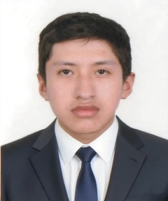

UNIVERSIDAD NACIONAL DE INGENIERÍA

 

FACULTAD DE INGENIERÍA INDUSTRIAL Y DE SISTEMAS

 

  

 

SW609U Sistemas de Gestión de Base de Datos

 

Entregable Capítulo 1

 

DOCENTE: Berrocal Navarro Richard Leonardo

 

Participantes del Grupo 1:

 

 - Chavarria Llamacponcca Renzo Moises 

 

 - Chinchayhuara Pantoja Mauricio Miguel 

 

 - Rojas Sanchez Jose Martin 

 

 - Vera Palacios Alvaro Martin 

 

 29 de octubre de 2026 

 

 2026 - II 

# Capítulo I: Introducción

## 1.1.   Startup profile

### 1.1.1.    Descripción del startup

**AgroProyectados** es una startup agrotecnológica enfocada en el desarrollo de software de gestión integral para granjas y fundos de producción mixta (agrícola y ganadera). Nuestro producto principal es **AgriTech**, un sistema digital diseñado para modernizar y automatizar el control operativo de pequeños y medianos productores. 

A través de nuestra plataforma, resolvemos problemas críticos del día a día, como la asignación de trabajadores a parcelas específicas, la trazabilidad del uso de insumos (semillas, fertilizantes) y el control zootécnico y genético de animales de crianza (vacunos y cuyes). El núcleo de nuestro software se apoya en una arquitectura de datos robusta, permitiendo transformar fundos que operan de manera empírica en negocios eficientes, escalables y respaldados por información exacta.

### 1.1.2.    Perfiles de integrantes del equipo

- Chavarria Llamacponcca Renzo Moises (20231281J): Estudiante de la carrera de Ing de Software en la Universidad Nacional de Ingeniería cursando el 7mo ciclo. Experiencia previa en base de datos sql y lenguajes de programación como python, c, c++ además de diseño web como HTML y css, considero que tengo gran capacidad de analisis y búsqueda de soluciones.

- Chinchayhuara Pantoja Mauricio Miguel (20244112G): Estudiante de la carrera de Ingenieria de Software en la Universidad Nacional de Ingeniería del Sexto Ciclo. Experiencia previa en Base de Datos SQL tales como MYSQL y SQLServer; lenguajes de programación como Python, Java y C++ y la capacidad de analizar casos extensos para un modelamiento de datos con gran cantidad de relaciones y tablas.

- Rojas Sanchez Jose Martin: 

- Vera Palacios Alvaro Martin (Código 20234137G): Estudiante de la carrera de Ingeniería de Software en la Universidad Nacional de Ingeniería, con sexto ciclo relativo, experiencia previa en bases de datos relacionales como PostgreSQL, Oracle, MySQL y SQL Server, en lenguajes de programación como Python. Java, C++, C y JavaScript, en frameworks con React y Express.js, con la capacidad de diseñar y estructurar ecosistemas con grandes cantidades de tablas.

  

## 1.2.   Solution profile

### 1.2.1.    Antecedentes y problemática

#### Problemática Central

La problemática central radica en la ausencia de herramientas de software y la total dependencia de registros manuales (cuadernos físicos y memoria visual) en la administración diaria de los fundos agropecuarios. Esta falta de digitalización genera islas de información que impiden tener una visión completa del negocio.

Al no contar con un sistema que integre ambas áreas (agricultura y ganadería), los productores son incapaces de rastrear el uso exacto de insumos en sus hectáreas, correlacionar la producción de forraje con la alimentación del ganado, o mantener un control genético y reproductivo estricto para especies de rápida multiplicación (como los cuyes). Esta desconexión operativa provoca una "ceguera administrativa" que oculta ineficiencias, dificulta la contención de enfermedades y frena el crecimiento comercial de la granja.

### 1.2.2.    Propuesta de valor

<table border="1" width="100%">
  <tr>
    <td><b>Problema del Negocio:</b> Las granjas agropecuarias sufren fugas de capital y pérdida de valor comercial debido a procesos ineficientes y no estandarizados. Al carecer de un software de gestión, el negocio asume sobrecostos constantes por la mala dosificación de insumos, horas-hombre desperdiciadas en la asignación de labores en las parcelas, y una fuerte devaluación de sus animales por la consanguinidad (cruce entre familiares) o mala rotación genética, limitando severamente sus márgenes de ganancia.</td>
    <td rowspan="2"><b>Soluciones Propuestas:</b> Implementar <b>AgriTech</b>, un sistema de gestión de base de datos relacional, seguro y escalable, que integre el registro de parcelas, lotes, animales,, genealogía, reproducción, sanidad, alimentación, peso, producción, mortalidad y ventas. La base de datos permitirá relacionar cada animal con su parcela, lote e historial productivo y sanitario, garantizando integridad referencial. Incluirá roles y permisos de acceso, reportes de producción y rentabilidad, alertas sanitarias y reproductivas, respaldo de información y una estructura multiempresa que permita al empresario ofrecer la solución a otros criadores de su rubro</td>
    <td><b>Resultados del Negocio:</b> Mediante la implementación de nuestro software, AgroProyectados espera que las granjas obtengan los siguientes resultados cuantificables:
    <ul>
      <li><b>Reducción de sobrecostos operativos:</b> Disminución en la pérdida y desperdicio de insumos agrícolas y veterinarios mediante un control estricto de inventarios vinculados a parcelas y corrales.</li>
      <li><b>Incremento del valor del ganado:</b> Aumento en los índices de natalidad sana y mejora en las métricas de engorde gracias al monitoreo genético y rotación inteligente de toros, vacas y cuyes.</li>
      <li><b>Eficiencia operativa unificada:</b> Eliminación del uso de papel y cuadernos, logrando que el productor pueda auditar el rendimiento de sus trabajadores y el estado de sus 2 hectáreas de cultivo en tiempo real desde una sola plataforma.</li>
    </ul></td>
  </tr>
  <tr>
    <td><b>Usuarios:</b> Empresarios agropecuarios y criadores de animales de ganado que poseen parcelas, y que buscan mejorar el rastreo de sus animales sin abandonar el conocimiento adquirido por experiencia. Usuarios operativos: responsables de la crianza que registran datos diarios. Usuarios técnicos: veterinarios y extensionistas que consultan historiales. Usuario administrador: gestiona usuarios, roles, reportes y licencias del sistema.</td>
    <td><b>Resultados y Beneficios del Usuario:</b> El empresario podrá conocer el historial reproductivo, sanitario y productivo de cada animal, tomar decisiones basadas en datos y respaldar su método empírico con información organizada. Podrá detectar oportunamente enfermedades, mejorar la alimentación y aumentar la productividad. Además, podrá ofrecer el sistema a otros criadores de su rubro, generando ingresos adicionales y posicionándose como referente en la facilitación de información para la crianza de animales de ganado</td>
  </tr>
  <tr>
    <td><b>Hipótesis:</b> X</td>
    <td><b>¿Qué es lo primero y más importante a saber?:</b> X</td>
    <td><b>¿Cuál es la menor cantidad de trabajo que necesitamos para aprender algo muy importante?:</b> X</td>
  </tr>
</table>

## 1.3.   Segmentos objetivo 

El segmento objetivo principal está conformado por empresarios agropecuarios y criadores que poseen parcelas, y que actualmente gestionan su producción a partir de experiencia empírica, registros manuales o información dispersa. Estos usuarios se caracterizan por necesitar registros más ordenados sobre reproducción, alimentación, sanidad, peso, mortalidad y producción, así como por visualizar una oportunidad de negocio al poder ofrecer el sistema a otros productores de su rubro.

Como segmento secundario se consideran las asociaciones, cooperativas y otros criadores de cuyes que requieren sistematizar su información y adoptar herramientas digitales para mejorar su producción. También se incluye a técnicos, veterinarios y extensionistas agropecuarios que brindan asesoría y necesitan consultar historiales productivos y sanitarios. Finalmente, el sistema contempla al empresario como futuro proveedor de la solución, ya que podrá comercializar el acceso al sistema a otros criadores interesados en facilitar la información para la crianza de animales de ganado.

