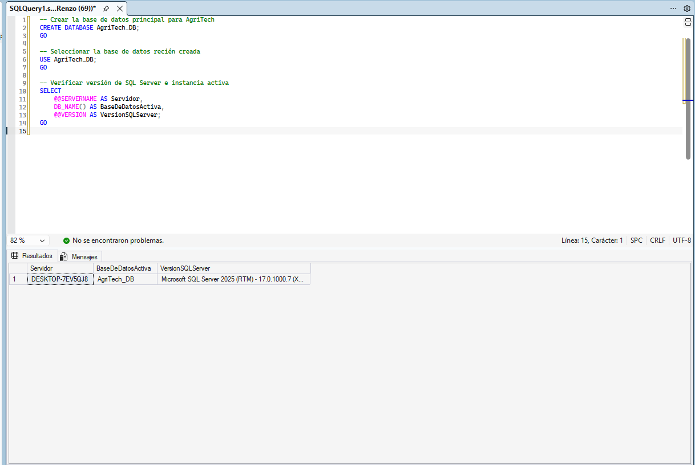

UNIVERSIDAD NACIONAL DE INGENIERÍA

 

FACULTAD DE INGENIERÍA INDUSTRIAL Y DE SISTEMAS

 

  

 

SW609U Sistemas de Gestión de Base de Datos

 

Entregable Capítulo 1

 

DOCENTE: Berrocal Navarro Richard Leonardo

 

Participantes del Grupo 1:

 

 - Chavarria Llamacponcca Renzo Moises 

 

 - Chinchayhuara Pantoja Mauricio Miguel 

 

 - Rojas Sanchez Jose Martin 

 

 - Vera Palacios Alvaro Martin 

 

 29 de octubre de 2026 

 

 2026 - II 

# Capítulo I: Introducción

## 1.1.   Startup profile

### 1.1.1.    Descripción del startup

**AgroProyecciones** es una startup agrotecnológica enfocada en el desarrollo de software de gestión integral para granjas y fundos de producción mixta (agrícola y ganadera). Nuestro producto principal es **AgriTech**, un sistema digital diseñado para modernizar y automatizar el control operativo de pequeños y medianos productores. 

A través de nuestra plataforma, resolvemos problemas críticos del día a día, como la asignación de trabajadores a parcelas específicas, la trazabilidad del uso de insumos (semillas, fertilizantes) y el control zootécnico y genético de animales de crianza (vacunos y cuyes). El núcleo de nuestro software se apoya en una arquitectura de datos robusta, permitiendo transformar fundos que operan de manera empírica en negocios eficientes, escalables y respaldados por información exacta.

### 1.1.2.    Perfiles de integrantes del equipo

- Chavarria Llamacponcca Renzo Moises (20231281J): Estudiante de la carrera de Ing de Software en la Universidad Nacional de Ingeniería cursando el 7mo ciclo. Experiencia previa en base de datos sql y lenguajes de programación como python, c, c++ además de diseño web como HTML y css, considero que tengo gran capacidad de analisis y búsqueda de soluciones.

- Chinchayhuara Pantoja Mauricio Miguel (20244112G): Estudiante de la carrera de Ingenieria de Software en la Universidad Nacional de Ingeniería del Sexto Ciclo. Experiencia previa en Base de Datos SQL tales como MYSQL y SQLServer; lenguajes de programación como Python, Java y C++ y la capacidad de analizar casos extensos para un modelamiento de datos con gran cantidad de relaciones y tablas.

- Rojas Sanchez Jose Martin (20244126H): Esduaitnate de la carrera de Ingeniería de Software, 6to ciclo, enfocado directamente en la creación de sistemas web y movil, con proyectos reales y desplegados en estas tecnologías. Además, cuento con experiencia manejando base de datos en producción, modificando reglas de seguridad y RLS's 

- Vera Palacios Alvaro Martin (Código 20234137G): Estudiante de la carrera de Ingeniería de Software en la Universidad Nacional de Ingeniería, con sexto ciclo relativo, experiencia previa en bases de datos relacionales como PostgreSQL, Oracle, MySQL y SQL Server, en lenguajes de programación como Python. Java, C++, C y JavaScript, en frameworks con React y Express.js, con la capacidad de diseñar y estructurar ecosistemas con grandes cantidades de tablas.

  

## 1.2.   Solution profile

### 1.2.1.    Antecedentes y problemática

### Matriz 5W y 2H

| Pregunta | Respuesta |
|---|---|
| **¿Qué? (What)** | Los fundos agropecuarios administran sus operaciones con cuadernos físicos y memoria, generando islas de información. No pueden rastrear el uso de insumos por parcela, asignar trabajadores de forma eficiente ni controlar la genealogía y reproducción del ganado. |
| **¿Por qué? (Why)** | La falta de digitalización genera "ceguera administrativa": sobrecostos por mala dosificación de insumos, horas-hombre desperdiciadas, consanguinidad en los animales y dificultad para contener enfermedades, lo que limita los márgenes de ganancia. |
| **¿Quién? (Who)** | Principal: empresarios agropecuarios y criadores que poseen parcelas. Secundario: asociaciones, cooperativas, veterinarios y extensionistas. Internamente: usuarios operativos y administrador del sistema. |
| **¿Dónde? (Where)** | En fundos y granjas de pequeños y medianos productores (parcelas de cultivo y corrales de vacunos y cuyes), con acceso desde celular o computadora. |
| **¿Cuándo? (When)** | En la operación diaria y durante todo el ciclo productivo: siembra, uso de insumos, empadre, gestación, engorde, sanidad y venta. |
| **¿Cómo? (How)** | Con AgriTech, un sistema de base de datos relacional que integra parcelas, lotes, animales, genealogía, sanidad, alimentación, producción y ventas, con roles de acceso, reportes, alertas y estructura multiempresa. |
| **¿Cuánto? (How much)** | Costo de desarrollo e implementación (por definir), modelo de licencias o suscripción para otros criadores, y ahorro esperado por menor desperdicio de insumos y mayor valor del ganado en las 2 hectáreas de cultivo. |

#### Problemática Central

La problemática central radica en la ausencia de herramientas de software y la total dependencia de registros manuales (cuadernos físicos y memoria visual) en la administración diaria de los fundos agropecuarios. Esta falta de digitalización genera islas de información que impiden tener una visión completa del negocio.

Al no contar con un sistema que integre ambas áreas (agricultura y ganadería), los productores son incapaces de rastrear el uso exacto de insumos en sus hectáreas, correlacionar la producción de forraje con la alimentación del ganado, o mantener un control genético y reproductivo estricto para especies de rápida multiplicación (como los cuyes). Esta desconexión operativa provoca una "ceguera administrativa" que oculta ineficiencias, dificulta la contención de enfermedades y frena el crecimiento comercial de la granja.

### 1.2.2.    Propuesta de valor

<table border="1" width="100%">
  <tr>
    <td><b>Problema del Negocio:</b> Las granjas agropecuarias sufren fugas de capital y pérdida de valor comercial debido a procesos ineficientes y no estandarizados. Al carecer de un software de gestión, el negocio asume sobrecostos constantes por la mala dosificación de insumos, horas-hombre desperdiciadas en la asignación de labores en las parcelas, y una fuerte devaluación de sus animales por la consanguinidad (cruce entre familiares) o mala rotación genética, limitando severamente sus márgenes de ganancia.</td>
    <td rowspan="2"><b>Soluciones Propuestas:</b> Implementar <b>AgriTech</b>, un sistema de gestión de base de datos relacional, seguro y escalable, que integre el registro de parcelas, lotes, animales, genealogía, reproducción, sanidad, alimentación, peso, producción, mortalidad y ventas. La base de datos permitirá relacionar cada animal con su parcela, lote e historial productivo y sanitario, garantizando integridad referencial. Incluirá roles y permisos de acceso, reportes de producción y rentabilidad, alertas sanitarias y reproductivas, respaldo de información y una estructura multiempresa que permita al empresario ofrecer la solución a otros criadores de su rubro</td>
    <td><b>Resultados del Negocio:</b> Mediante la implementación de nuestro software, AgroProyecciones espera que las granjas obtengan los siguientes resultados cuantificables:
    <ul>
      <li><b>Reducción de sobrecostos operativos:</b> Disminución en la pérdida y desperdicio de insumos agrícolas y veterinarios mediante un control estricto de inventarios vinculados a parcelas y corrales.</li>
      <li><b>Incremento del valor del ganado:</b> Aumento en los índices de natalidad sana y mejora en las métricas de engorde gracias al monitoreo genético y rotación inteligente de toros, vacas y cuyes.</li>
      <li><b>Eficiencia operativa unificada:</b> Eliminación del uso de papel y cuadernos, logrando que el productor pueda auditar el rendimiento de sus trabajadores y el estado de sus 2 hectáreas de cultivo en tiempo real desde una sola plataforma.</li>
    </ul></td>
  </tr>
  <tr>
    <td><b>Usuarios:</b> Empresarios agropecuarios y criadores de animales de ganado que poseen parcelas, y que buscan mejorar el rastreo de sus animales sin abandonar el conocimiento adquirido por experiencia. Usuarios operativos: responsables de la crianza que registran datos diarios. Usuarios técnicos: veterinarios y extensionistas que consultan historiales. Usuario administrador: gestiona usuarios, roles, reportes y licencias del sistema.</td>
    <td><b>Resultados y Beneficios del Usuario:</b> El empresario podrá conocer el historial reproductivo, sanitario y productivo de cada animal, tomar decisiones basadas en datos y respaldar su método empírico con información organizada. Podrá detectar oportunamente enfermedades, mejorar la alimentación y aumentar la productividad. Además, podrá ofrecer el sistema a otros criadores de su rubro, generando ingresos adicionales y posicionándose como referente en la facilitación de información para la crianza de animales de ganado</td>
  </tr>
  <tr>
    <td><b>Hipótesis:</b> 
    <ul>
      <li><b>Hipótesis de Adopción y Eficiencia:</b> Creemos que al proveer a los empresarios y operarios agrícolas una interfaz sencilla para registrar insumos y labores por parcela en lugar de cuadernos físicos, se reducirá el desperdicio de insumos en un 20%. Sabremos que tuvimos éxito cuando el 85% de las labores diarias sean registradas digitalmente durante el primer mes de uso.</li>
      <li><b>Hipótesis de Control Zootécnico:</b> Creemos que al incorporar un control genealógico con alertas automáticas de consanguinidad para vacunos y cuyes, aumentará la tasa de crías sanas y el valor comercial del ganado. Sabremos que tuvimos éxito cuando los cruces consanguíneos involuntarios se reduzcan a 0% y la supervivencia de crías aumente en un 15%.</li>
      <li><b>Hipótesis de Escalabilidad y Negocio:</b> Creemos que al estructurar el sistema con capacidades multiempresa y reportes de rentabilidad, los empresarios agropecuarios estarán dispuestos a pagar un modelo de suscripción o licencia y comercializar la solución a otros criadores del rubro. Sabremos que tuvimos éxito cuando al menos 3 granjas piloto decidan contratar el servicio tras el período de evaluación.</li>
    </ul></td>
    <td><b>¿Qué es lo primero y más importante a saber?:</b> 
    <ul>
      <li><b>Disposición y facilidad de adopción operativa:</b> Determinar si los trabajadores y operarios de campo (con fuerte arraigo en prácticas empíricas y baja familiaridad digital) realmente utilizarán la plataforma de manera constante y sin fricción para registrar labores diarias, o si el ingreso de datos será percibido como una sobrecarga de trabajo.</li>
      <li><b>Viabilidad de la información genealógica inicial:</b> Identificar si los criadores poseen suficiente trazabilidad histórica o datos confiables para poblar el registro inicial de parentesco de sus animales de crianza y validar la efectividad de las alertas reproductivas.</li>
      <li><b>Disposición real de pago y valor percibido:</b> Confirmar si el ahorro operativo generado en insumos y la reducción de pérdidas en animales son lo suficientemente tangibles como para que el productor justifique la inversión en licencias del software.</li>
    </ul></td>
    <td><b>¿Cuál es la menor cantidad de trabajo que necesitamos para aprender algo muy importante?:</b> 
    <ul>
      <li><b>Desarrollo de un MVP Core (Prototipo funcional mínimo):</b> Construir una versión ligera y accesible desde celular/computadora centrada únicamente en dos flujos esenciales:
        <ol>
          <li>Formulario simplificado para el registro diario de insumos aplicados a una parcela específica.</li>
          <li>Ficha zootécnica elemental con verificación instantánea de parentesco (evitar consanguinidad) al programar un cruce o empadre.</li>
        </ol>
      </li>
      <li><b>Prueba piloto de campo (2 a 3 semanas):</b> Desplegar este MVP en un entorno controlado (las 2 hectáreas de cultivo y un corral piloto de cuyes o vacunos) con un operario clave y el empresario agropecuario.</li>
      <li><b>Mecanismos de medición y aprendizaje directo:</b> Evaluar la tasa de registro efectivo frente al cuaderno tradicional, registrar el tiempo invertido por carga de datos y realizar entrevistas cortas in situ para identificar bloqueos de usabilidad antes de invertir recursos en módulos avanzados o multiempresa.</li>
    </ul></td>
  </tr>
</table>

## 1.3.   Segmentos objetivo 

El segmento objetivo principal está conformado por empresarios agropecuarios y criadores que poseen parcelas, y que actualmente gestionan su producción a partir de experiencia empírica, registros manuales o información dispersa. Estos usuarios se caracterizan por necesitar registros más ordenados sobre reproducción, alimentación, sanidad, peso, mortalidad y producción, así como por visualizar una oportunidad de negocio al poder ofrecer el sistema a otros productores de su rubro.

Como segmento secundario se consideran las asociaciones, cooperativas y otros criadores de cuyes que requieren sistematizar su información y adoptar herramientas digitales para mejorar su producción. También se incluye a técnicos, veterinarios y extensionistas agropecuarios que brindan asesoría y necesitan consultar historiales productivos y sanitarios. Finalmente, el sistema contempla al empresario como futuro proveedor de la solución, ya que podrá comercializar el acceso al sistema a otros criadores interesados en facilitar la información para la crianza de animales de ganado.

# Capítulo II: Recopilación y análisis de requisitos

## 2.1 Entrevistas

### 2.1.1 Diseño de entrevistas

Para poder validar todo lo hablado en el capítulo I, se ha buscado realizar la entrevista a un dueño o administrador de una granja.

Para ello se ha desarrollado distintos bloques enfocados en distintos temas donde se plantearon las siguientes preguntas:

#### - Bloque 1: Contexto Operativo y Estructura del Negocio
- ¿Cómo está organizada físicamente la granja actualmente (hectáreas de cultivo, galpones de cuyes, pozas, establos, etc)?

- ¿Qué personal labora en el fundo y cómo se delegan o supervisan las tareas diarias (cuadernos, indicaciones verbales, WhatsApp)?

- ¿Cuáles son los principales cuellos de botella administrativos o pérdidas económicas que experimenta en el día a día?

#### - Bloque 2: Cultivos, Parcelas e Insumos Agrícolas
- ¿Cómo registran el stock y la aplicación de insumos (semillas, fertilizantes, pesticidas) por cada lote o parcela?

- ¿Existe una relación directa entre las cosechas de forraje y la alimentación del ganado/cuyes, o se maneja como un inventario independiente?

#### - Bloque 3: Crianza de Cuyes y Programa de Mejora Genética (Eje Central)
- ¿Cómo identifican individualmente o por lote a los reproductores y reproductores élite (aretes, muescas, tatuaje, placas en pozas)?

- ¿Qué líneas manejan (Perú, Andina, Inti, criollos)? ¿Cuentan hoy con historial escrito de padres/abuelos para evitar la consanguinidad?

- ¿Qué datos registran al momento de la parición (tamaño de camada, crías vivas/muertas, peso al destete)?

- ¿Bajo qué parámetros seleccionan a los cuyes destinados a pie de cría (mejora genética) frente a los destinados a beneficio/carne (ganancia diaria de peso, prolificidad, conformación)?

- ¿Cómo controlan las bajas (mortalidad), causas comunes y los tratamientos sanitarios preventivos o curativos?

#### - Bloque 4: Ganado Vacuno
- ¿Cuál es el propósito del hato vacuno (leche, carne, doble propósito)?

- ¿Qué eventos veterinarios requieren registrar de forma mandatoria (vacunas, desparasitaciones, control mastitis, inseminación/monta natural)?

#### - Bloque 5: Adopción Tecnológica y Requisitos No Funcionales (BD & App)
- ¿Los trabajadores que registran labores usan smartphones personales o se designará un dispositivo central?

- ¿Qué reporte o resumen le gustaría ver cada mañana para tomar decisiones antes de iniciar la jornada (alertas de empadre, stock bajo, costos de insumos)?

### 2.1.2 Registro de entrevistas

#### 2.1.2.1 Ficha Técnica de la Entrevista

- **Entrevistado:** Dueño / Administrador de la Granja D'Alejos.
- **Entrevistadores:** Equipo de AgroProyecciones.
- **Objetivo principal:** Levantar las reglas de negocio, entidades, atributos, flujos operativos y métricas críticas de la granja (ganado vacuno, cuyes, cultivos y mejora genética) para diseñar la base de datos relacional y validar las hipótesis del MVP.
- **Modalidad:** Virtual con grabación autorizada.
- **Link de Entrevista:** https://drive.google.com/file/d/1qtcShp3ZaVf1Kd2DCxAVF852t-Jcdkq-/view

#### 2.1.2.2. Estructura y Cronograma de la Sesión
|Fase|Duración|Objetivo|
|---|---|---|
|I. Introducción y Apertura|5 min|Encuadre del proyecto, agradecimiento y solicitud de consentimiento para grabar|
|II. Contexto General y Estructura del Fundo|10 min|Dimensionamiento de parcelas, corrales y personal.|
|III. Módulo Agrícola y Manejo de Insumos|10 min|Trazabilidad de siembra, fertilización, forraje y labores.|
|IV. Módulo Zootécnico: Cuyes y Mejora Genética|15 min|Identificación, líneas genéticas, empadres, consanguinidad y camadas.|
|V. Módulo Pecuario: Ganado Vacuno|8 min|Control de ganado, sanidad, pesaje y alimentación.|
|VI. Viabilidad Técnica, Usabilidad y Cierre|12 min|Dispositivos disponibles, conectividad, expectativas y acuerdos de MVP.|

### 2.1.3 Análisis de entrevistas

A partir de la entrevista realizada al segmento principal (empresarios agropecuarios y criadores), se identificaron patrones claros en relación con las necesidades, dificultades y expectativas frente a la gestión de sus fundos. La entrevista, realizada a Demetrio Rojas, gerente de una granja dedicada a la crianza de vacunos de doble propósito y cuyes con mejoramiento genético, reveló que las personas de este segmento gestionan sus operaciones combinando la agricultura (2 hectáreas de alfalfa en el caso del señor Rojas) con la ganadería, apoyándose en un equipo de trabajo reducido y con tareas calendarizadas.

En primer lugar, se evidenció que la principal dificultad operativa radica en la dependencia de registros manuales. El entrevistado manifestó que los datos sobre nacimientos, pesos, destetes, sexado y mortalidad se anotan en cuadernos y hojas físicas. Esta falta de digitalización genera una "ceguera administrativa", ya que el entrevistado indicó que la toma de decisiones, como cambios de raza o ajustes en la alimentación, se retrasa hasta por 15 o 30 días, tiempo en el que se comparan anotes manuales, lo que muchas veces resulta en pérdidas económicas o fracasos en los lotes de animales.

Asimismo, se identificó una marcada preocupación por el control zootécnico y genético. El entrevistado destacó la necesidad de rastrear eventos veterinarios (desparasitaciones, vitaminas, tratamientos para neumonía o salmonelosis) y, sobre todo, de evitar cruces no adecuados entre líneas o razas. Actualmente, identificar si un problema de natalidad o mortalidad de crías se debe al macho o a las hembras toma hasta un año de prueba y error. Frente a ello, se valoró la necesidad de contar con una herramienta que les permita verificar el parentesco y optimizar la conversión alimenticia en tiempo real.

Por otro lado, se detectaron limitaciones tecnológicas y de acceso a la información. El entrevistado señaló que, aunque existen experiencias internacionales de monitoreo con sensores, en el sector rural peruano la falta de herramientas digitales limita el crecimiento. Se enfatizó la necesidad de un aplicativo que no solo registre datos, sino que también brinde información oportuna sobre el comportamiento del mercado (precios de la carne, fenómenos climáticos) y alertas tempranas ante cambios bruscos de estación, los cuales incrementan la mortalidad en cuyes.

Desde la perspectiva del acceso operativo, se observó que la solución debe ser intuitiva, dado que el personal de campo (asistentes) es quien registrará los datos diarios. El entrevistado subrayó que la plataforma debe adaptarse a la rutina del fundo y permitir la consulta desde dispositivos móviles o computadoras, eliminando la necesidad de estar físicamente presente en los corrales para revisar el avance de la producción.

En cuanto al segmento secundario (asociaciones, cooperativas, criadores de cuyes y técnicos/veterinarios), no se cuenta aún con entrevistas registradas que permitan un sustento estadístico. Sin embargo, a partir de las hipótesis del proyecto, se proyecta que estos usuarios demandarán funcionalidades de centralización de información, historiales clínicos compartidos y herramientas para la comercialización de licencias, lo cual deberá validarse en futuras iteraciones.

Finalmente, se concluye que una solución para el sector agropecuario debe ser accesible, bilingüe o de lenguaje sencillo, adaptable a la baja conectividad y centrada en la trazabilidad en tiempo real. A partir de estos hallazgos, se define el siguiente arquetipo preliminar para el segmento principal: "El empresario agropecuario empírico", un gerente que posee fundos mixtos, trabaja con personal reducido, necesita digitalizar sus cuadernos de campo para evitar la consanguinidad, optimizar la alimentación y tomar decisiones basadas en datos para asegurar la rentabilidad de su negocio.

## 2.2 Requisitos

### 2.2.1. Requisitos Funcionales

| Código | Nombre | Descripción |
| :--- | :--- | :--- |
| **RF-01** | Gestión Agrícola | El sistema debe permitir el registro y control de parcelas de cultivo.|
| **RF-02** | Trazabilidad de Insumos | El software debe registrar de manera exacta el uso y dosificación de insumos agrícolas (semillas, fertilizantes) vinculándolos a cada parcela. |
| **RF-03** | Control Zootécnico | El sistema debe permitir el registro de perfiles individuales o por lotes de animales, rastreando su peso, crecimiento y mortalidad. |
| **RF-04** | Registro Genealógico | El sistema debe mantener un registro exacto del parentesco (línea de ascendencia y descendencia) de cada animal registrado en la granja. |
| **RF-05** | Alertas Reproductivas | El sistema debe evaluar el parentesco y generar alertas automáticas al programar empadres para prevenir cruces con consanguinidad. |
| **RF-06** | Control Sanitario | El sistema debe mantener el historial clínico de los animales, registrando enfermedades diagnosticadas, tratamientos aplicados y vacunas. |
| **RF-07** | Gestión de Alimentación | El sistema debe permitir el registro y asignación de esquemas de alimentación (raciones y consumo de forraje) para cada animal o lote. |
| **RF-08** | Generación de Reportes | El sistema debe generar reportes automáticos y cuadros de mando sobre las métricas de producción y la rentabilidad general de la granja. |
| **RF-09** | Registro de Ventas | El sistema debe contar con un módulo transaccional para registrar las ventas finales de los animales y cultivos. |
| **RF-10** | Gestión de Accesos | El sistema debe incluir un módulo para la administración de usuarios y roles con permisos específicos (administrador, operarios de campo, veterinarios). |
| **RF-11** | Módulo Multiempresa | El software debe contar con aislamiento de datos por cuenta (multi-tenant) para que el empresario principal pueda comercializar licencias a otros criadores. |

### 2.2.2. Requisitos No Funcionales

| Código | Nombre | Descripción |
| :--- | :--- | :--- |
| **RNF-01** | Rendimiento | El sistema debe procesar las consultas de los reportes de producción (cruces entre parcelas, animales e insumos) y renderizar la información en pantalla en un tiempo máximo de 1 s egundobajo condiciones de carga normal. |
| **RNF-02** | Integridad de Datos | Se debe garantizar la coherencia estricta entre animales, parcelas y su historial, sin redundancias. |
| **RNF-03** | Usabilidad | La interfaz debe ser intuitiva y guiada, permitiendo que operarios de campo sin experiencia tecnológica avanzada registren insumos o tareas. |
| **RNF-04** | Adaptabilidad | Las vistas del sistema deben renderizarse y funcionar correctamente en los dispositivos disponibles. |
| **RNF-05** | Seguridad de Acceso | El sistema debe encriptar las credenciales de los usuarios y bloquear el acceso a módulos no autorizados según el rol asignado. |
| **RNF-06** | Respaldo de Información | El sistema debe ejecutar copias de seguridad (backups) automáticas de manera diaria para salvaguardar todos los registros operativos y comerciales de las granjas. |
| **RNF-07** | Escalabilidad | La arquitectura backend y de base de datos debe soportar el crecimiento continuo del esquema multiempresa sin que el tiempo de respuesta de las consultas supere los 2 segundos. |

# Capítulo III: DIseño de Base de Datos

## 3.1. Entidades
En la siguiente tabla, se especifica las entidades identificadas en base a la entrevista presentada:

|Entidad|Descripción|
|---|---|
|Empresa|Entidad que almacena los datos de cada granja o empresa cliente|
|Usuario|Entidad que identifica las credenciales de acceso|
|Rol|Entidad que representa los niveles de acceso|
|Usuario_Rol|Entidad que designa uno o más roles a un usuario|
|Trabajador|Entidad que almacena los datos personales del personal de campo de cada empresa|
|Tipo_Labor|Entidad que contiene el catálogo de tareas que se pueden realizar en la empresa|
|Registro_Labor|Entidad que almacena el historial sobre qué trabajador hizo qué labor, en qué fecha y cuántas horas invirtió|
|Parcela|Entidad que contiene las subdivisiones de tierra de la empresa|
|Especie_Cultivo|Entidad que contiene el catálogo de lo que se siembra|
|Ciclo_Siembra|Entidad que vincula Cultivo con Parcela con el rango de fechas esperado|
|Cosecha|Entidad que almacena el registro del rendimiento final obtenido en el ciclo de siembre|
|Especie_Animal|Entidad que cataloga las diferentes especies criadas en la granja (ej. Vacuno, Cuy, Ovino)|
|Raza|Entidad que clasifica las razas específicas correspondientes a cada especie animal|
|Corral|Entidad que representa la ubicación física (corrales o pozas) donde se alojan o agrupan los animales|
|Animal|Entidad central que registra los datos individuales (arete, nacimiento) y las llaves de parentesco (padre y madre) para la genealogía|
|Lote_Animal|Entidad que agrupa animales menores (como los cuyes) para gestionar su trazabilidad en bloque|
|Control_Peso|Entidad que almacena el historial de pesaje y crecimiento de un animal o lote en fechas determinadas|
|Empadre|Entidad que registra el cruce o monta entre un macho y una hembra, calculando la fecha esperada de parto|
|Parto|Entidad que detalla los resultados de un empadre, registrando el número de crías vivas, muertas y complicaciones|
|Enfermedad|Entidad que contiene el catálogo de enfermedades comunes|
|Diagnostico|Entidad que almacena los diagnosticos hechos hacia un animal|
|Tratamiento_Sanitario|Entidad que almacena el registro de la intervención aplicada a un animal o lote|
|Racion_Dieta|Entidad que registra las fórmula o combinaciones de alimento preparadas para distintas etapas|
|Consumo_Alimentacion|Entidad que contiene la cantidad exacta de ración asignada a un animal, lote o corral por día|
|Categoria_Insumo|Entidad que clasifica los tipos de productos del almacén (ej. Fertilizante, Medicina, Concentrado)|
|Insumo|Entidad que detalla los productos específicos que la granja tiene registrados en su inventario|
|Kardex_Inventario|Entidad transaccional que registra las entradas (compras) y salidas (uso o merma) para mantener el stock actualizado|
|Aplicacion_Insumo|Entidad intermedia que vincula el retiro de un insumo del almacén con su uso exacto en el campo o en un animal|
|Cliente|Entidad que almacena los datos comerciales de los compradores finales o intermediarios|
|Venta|Entidad de cabecera que registra los datos generales de la transacción comercial (fecha, total, cliente)|
|Detalle_Venta|Entidad que desglosa los ítems específicos (animales, cultivos o derivados) incluidos en una venta|
|Planificacion_Actividad|Entidad que programa las labores futuras (como limpieza o alimentación) asignando fecha, hora, tipo de labor y trabajador|

## 3.2. Atributos

Los atributos de las entidades identificadas son:

### Tabla Empresa
| Atributo | Descripción | Tipo de dato | Clave |
|---|---|---|---|
| `id_empresa` | Identificador único de la empresa o granja | INT | PRIMARY KEY |
| `ruc` | RUC de la empresa o fundo | VARCHAR(11) ||
| `nombre` | Nombre o razón social de la empresa/granja | VARCHAR(150) ||
| `direccion` | Dirección fiscal o ubicación de la granja | VARCHAR(200) ||
| `estado` | Indica si la empresa está activa o inactiva | BOOLEAN ||

### Tabla Usuario
| Atributo | Descripción | Tipo de dato | Clave |
|---|---|---|---|
| `id_usuario` | Identificador único del usuario |INT | PRIMARY KEY |
| `id_empresa` | Empresa o granja a la que pertenece el usuario | INT |FOREIGN KEY |
| `id_trabajador`| Identificador único del trabajador que se le crea un usuario|INT |FOREIGN KEY|
| `email` | Correo electrónico usado como credencial de acceso| VARCHAR(150) |
| `contrasena_hash` | Contraseña encriptada o hash de la contraseña | VARCHAR(255) |
| `nombre_usuario` | Nombre visible del usuario dentro del sistema | VARCHAR(100) |
| `fecha_creacion` | Fecha y hora de creación del usuario | TIMESTAMP |
| `ultimo_acceso` | Fecha y hora del último inicio de sesión | TIMESTAMP |
| `estado` | Indica si el usuario está activo o bloqueado | BOOLEAN |

### Tabla Rol
| Atributo | Descripción | Tipo de dato | Clave |
|---|---|---|---|
| `id_rol` | Identificador único del rol | INT |PRIMARY KEY|
| `nombre_rol` | Nombre del rol: Administrador, Operario, Veterinario, etc. | VARCHAR(50)|
| `descripcion` | Descripción de las funciones o permisos del rol | TEXT |
| `estado` | Indica si el rol está activo o inactivo | BOOLEAN |

### Tabla Usuario_Rol
| Atributo | Descripción | Tipo de dato | Clave |
|---|---|---|---|
| `id_usuario` | Usuario al que se le asigna el rol. Parte de la clave primaria compuesta | INT |FOREIGN KEY |
| `id_rol` | Rol asignado al usuario. Parte de la clave primaria compuesta | INT |FOREIGN KEY |
| `fecha_asignacion` | Fecha y hora en que se asignó el rol al usuario | TIMESTAMP |
| `estado` | Indica si la asignación del rol está vigente | BOOLEAN |

### Tabla Trabajador
| Atributo | Descripción | Tipo de dato | Clave |
|---|---|---|---|
| `id_trabajador` | Identificador único del trabajador | INT |PRIMARY KEY |
| `id_empresa` | Empresa o granja a la que pertenece el trabajador | INT |FOREIGN KEY |
| `dni` | Documento nacional de identidad del trabajado | CHAR(8)|
| `nombres` | Nombres del trabajador | VARCHAR(100) |
| `apellidos` | Apellidos del trabajador | VARCHAR(100) |
| `telefono` | Número de contacto del trabajador | VARCHAR(20) |
| `direccion` | Dirección del trabajador | VARCHAR(200) |
| `fecha_nacimiento` | Fecha de nacimiento del trabajador | DATE |
| `fecha_ingreso` | Fecha en que ingresó a laborar en la empresa | DATE |
| `cargo` | Cargo o función principal del trabajador | VARCHAR(100) |
| `estado` | Indica si el trabajador está activo o inactivo | BOOLEAN |

### Tabla Tipo_Labor
| Atributo | Descripción | Tipo de dato | Clave |
|---|---|---|---|
| `id_tipo_labor` | Identificador único del tipo de labor |INT | PRIMARY KEY |
| `id_empresa`| Identificador de empresa para que la lista de labores sea diferente para cada una | INT |FOREIGN KEY|
| `nombre_labor` | Nombre de la labor: Riego, Desparasitación, Siembra, Cosecha, etc. | VARCHAR(100) |
| `descripcion` | Descripción detallada de la labor | TEXT |
| `estado` | Indica si el tipo de labor está activo o inactivo | BOOLEAN |

### Tabla Registro_Labor
| Atributo | Descripción | Tipo de dato | Clave |
|---|---|---|---|
| `id_registro_labor` | Identificador único del registro de labor |INT | PRIMARY KEY |
| `id_trabajador` | Trabajador que realizó la labor | INT |FOREIGN KEY |
| `id_tipo_labor` | Tipo de labor realizada |INT | FOREIGN KEY |
| `fecha_labor` | Fecha en que se realizó la labor | DATE |
| `horas_invertidas` | Cantidad de horas invertidas en la labor | DECIMAL(5,2) |
| `observaciones` | Comentarios adicionales sobre la labor realizada | TEXT |
| `fecha_registro` | Fecha y hora en que se registró la labor en el sistema | TIMESTAMP |
| `estado` | Indica si el registro está vigente o anulado | BOOLEAN |

### Tabla Parcela
| Atributo | Descripción | Tipo de dato | Clave |
|---|---|---|---|
| `id_parcela` | Identificador único de la parcela |INT | PRIMARY KEY |
| `id_empresa` | Empresa o granja a la que pertenece la parcela | INT |FOREIGN KEY |
| `nombre_parcela` | Nombre o código de la parcela, por ejemplo: "Hectárea 1", "Hectárea 2" | VARCHAR(100) |
| `tamano_hectareas` | Tamaño de la parcela expresado en hectáreas | DECIMAL(10,2) |
| `ubicacion` | Ubicación o referencia física de la parcela dentro del fundo | VARCHAR(200) |
| `tipo_suelo` | Tipo o característica del suelo de la parcela | VARCHAR(100) |
| `estado` | Indica si la parcela está disponible, en uso o inactiva | VARCHAR(20) |
| `observaciones` | Comentarios adicionales sobre la parcela | TEXT |

### Tabla Especie_Cultivo
| Atributo | Descripción | Tipo de dato | Clave |
|---|---|---|---|
| `id_especie_cultivo` | Identificador único de la especie o tipo de cultivo | INT |PRIMARY KEY |
| `nombre_cultivo` | Nombre del cultivo: Maíz chala, Alfalfa, etc. | VARCHAR(100) |
| `descripcion` | Descripción del cultivo y sus características | TEXT |
| `tipo_cultivo` | Clasificación del cultivo: forraje, grano, hortaliza, etc. | VARCHAR(50) |
| `ciclo_dias_promedio` | Duración promedio del ciclo de siembra en días | INTEGER |
| `estado` | Indica si el cultivo está activo en el catálogo | BOOLEAN |

### Tabla Ciclo_Siembra
| Atributo | Descripción | Tipo de dato | Clave |
|---|---|---|---|
| `id_ciclo_siembra` | Identificador único del ciclo de siembra |INT | PRIMARY KEY |
| `id_parcela` | Parcela donde se realiza la siembra |INT | FOREIGN KEY|
| `id_especie_cultivo` | Cultivo sembrado en la parcela |INT |FOREIGN KEY|
| `fecha_inicio` | Fecha de inicio de la siembra | DATE |
| `fecha_fin_esperada` | Fecha estimada de fin del ciclo de siembra | DATE |
| `fecha_fin_real` | Fecha real en que finalizó el ciclo, si ya concluyó | DATE |
| `area_sembrada` | Área efectivamente sembrada en hectáreas | DECIMAL(10,2) |
| `estado` | Estado del ciclo: en curso, finalizado, cancelado | VARCHAR(20) |
| `observaciones` | Comentarios adicionales sobre el ciclo de siembra | TEXT |

### Tabla Cosecha
| Atributo | Descripción | Tipo de dato | Clave |
|---|---|---|---|
| `id_cosecha` | Identificador único de la cosecha | INT |PRIMARY KEY |
| `id_ciclo_siembra` | Ciclo de siembra del que se obtiene la cosecha | INT |FOREIGN KEY |
| `fecha_cosecha` | Fecha en que se realizó la cosecha | DATE |
| `cantidad_obtenida` | Cantidad total obtenida en la cosecha | DECIMAL(12,2) |
| `unidad_medida` | Unidad de medida del rendimiento: kg, toneladas, etc. | VARCHAR(20) |
| `calidad` | Calidad o categoría del producto cosechado | VARCHAR(50) |
| `observaciones` | Comentarios adicionales sobre la cosecha | TEXT |
| `fecha_registro` | Fecha y hora en que se registró la cosecha en el sistema | TIMESTAMP |

### Tabla Especie_Animal
| Atributo | Descripción | Tipo de dato | Clave |
|---|---|---|---|
| `id_especie_animal` | Identificador único de la especie | INT | PRIMARY KEY |
| `nombre_especie` | Nombre de la especie: Vacuno, Cuy, Ovino, etc. | VARCHAR(100) | |
| `descripcion` | Descripción general de la especie | TEXT | |
| `estado` | Indica si la especie está activa en el catálogo | BOOLEAN | |

### Tabla Raza
| Atributo | Descripción | Tipo de dato | Clave |
|---|---|---|---|
| `id_raza` | Identificador único de la raza | INT | PRIMARY KEY |
| `id_especie_animal` | Especie a la que pertenece la raza | INT | FOREIGN KEY |
| `nombre_raza` | Nombre de la raza: Holstein, Andina, etc. | VARCHAR(100) | |
| `descripcion` | Características fenotípicas o propósito de la raza | TEXT | |
| `estado` | Indica si la raza está activa en el catálogo | BOOLEAN | |

### Tabla Corral
| Atributo | Descripción | Tipo de dato | Clave |
|---|---|---|---|
| `id_corral` | Identificador único del corral, galpón o poza | INT | PRIMARY KEY |
| `id_empresa` | Empresa o granja a la que pertenece el corral | INT | FOREIGN KEY |
| `nombre_corral` | Código o nombre identificador del corral | VARCHAR(100) | |
| `capacidad_maxima` | Número máximo de animales que puede albergar | INT | |
| `ubicacion` | Ubicación física dentro del fundo | VARCHAR(200) | |
| `estado` | Indica si el corral está en uso, en mantenimiento o inactivo | VARCHAR(50) | |

### Tabla Animal
| Atributo | Descripción | Tipo de dato | Clave |
|---|---|---|---|
| `id_animal` | Identificador único interno del animal | INT | PRIMARY KEY |
| `id_empresa` | Empresa o granja propietaria del animal | INT | FOREIGN KEY |
| `id_raza` | Raza del animal | INT | FOREIGN KEY |
| `id_corral` | Corral o ubicación actual del animal | INT | FOREIGN KEY |
| `id_padre` | Identificador del padre (Clave foránea recursiva a Animal) | INT | FOREIGN KEY |
| `id_madre` | Identificador de la madre (Clave foránea recursiva a Animal) | INT | FOREIGN KEY |
| `codigo_arete` | Código físico visible en el animal (arete, tatuaje, muesca) | VARCHAR(50) | UNIQUE |
| `sexo` | Sexo del animal (M/F) | CHAR(1) | |
| `fecha_nacimiento` | Fecha en que nació el animal | DATE | |
| `proposito` | Fin zootécnico: Carne, Leche, Pie de cría (reproducción) | VARCHAR(50) | |
| `estado_vital` | Estado actual: Vivo, Muerto, Vendido | VARCHAR(50) | |

### Tabla Lote_Animal
| Atributo | Descripción | Tipo de dato | Clave |
|---|---|---|---|
| `id_lote_animal` | Identificador único del lote | INT | PRIMARY KEY |
| `id_empresa` | Empresa o granja propietaria del lote | INT | FOREIGN KEY |
| `id_raza` | Raza predominante del lote | INT | FOREIGN KEY |
| `id_corral` | Corral o poza donde se ubica el lote | INT | FOREIGN KEY |
| `codigo_lote` | Nombre o código de referencia del lote | VARCHAR(100) | |
| `fecha_creacion` | Fecha en que se agrupó el lote | DATE | |
| `cantidad_inicial` | Número de animales al crear el lote | INT | |
| `cantidad_actual` | Número de animales vivos en el lote en la actualidad | INT | |
| `proposito` | Fin zootécnico del lote (ej. Engorde) | VARCHAR(50) | |
| `estado` | Indica si el lote está activo o cerrado (vendido/beneficiado) | BOOLEAN | |

### Tabla Control_Peso
| Atributo | Descripción | Tipo de dato | Clave |
|---|---|---|---|
| `id_control_peso` | Identificador único del registro de pesaje | INT | PRIMARY KEY |
| `id_animal` | Animal pesado (nulo si el pesaje es por lote) | INT | FOREIGN KEY |
| `id_lote_animal` | Lote pesado (nulo si el pesaje es individual) | INT | FOREIGN KEY |
| `fecha_pesaje` | Fecha en que se tomó el peso | DATE | |
| `peso_registrado` | Peso registrado en balanza | DECIMAL(10,2) | |
| `unidad_medida` | Unidad del peso (Kg, gr) | VARCHAR(20) | |
| `observaciones` | Comentarios sobre el estado del animal/lote al pesar | TEXT | |

### Tabla Empadre
| Atributo | Descripción | Tipo de dato | Clave |
|---|---|---|---|
| `id_empadre` | Identificador único del registro de cruce | INT | PRIMARY KEY |
| `id_padre` | Animal macho utilizado como reproductor | INT | FOREIGN KEY |
| `id_madre` | Animal hembra empadrada | INT | FOREIGN KEY |
| `id_trabajador` | Empleado responsable de supervisar el cruce | INT | FOREIGN KEY |
| `fecha_empadre` | Fecha en que ocurrió la monta o inseminación | DATE | |
| `tipo_empadre` | Monta natural, Inseminación artificial, etc. | VARCHAR(50) | |
| `fecha_parto_esperada` | Fecha calculada para el nacimiento | DATE | |
| `estado_gestacion` | Confirmada, Fallida, Pendiente de confirmación | VARCHAR(50) | |

### Tabla Parto
| Atributo | Descripción | Tipo de dato | Clave |
|---|---|---|---|
| `id_parto` | Identificador único del evento de parto | INT | PRIMARY KEY |
| `id_empadre` | Registro del cruce que originó este parto | INT | FOREIGN KEY |
| `fecha_parto_real` | Fecha exacta en que ocurrió el nacimiento | DATE | |
| `crias_vivas` | Cantidad de crías que nacieron vivas | INT | |
| `crias_muertas` | Cantidad de crías que nacieron muertas | INT | |
| `peso_camada_total` | Peso total de las crías al nacer | DECIMAL(10,2) | |
| `complicaciones` | Descripción de problemas durante el parto (distocia, retención) | TEXT | |
| `estado` | Indica si el registro es válido | BOOLEAN | |

### Tabla Enfermedad
| Atributo | Descripción | Tipo de dato | Clave |
|---|---|---|---|
| `id_enfermedad` | Identificador único de la enfermedad | INT |PRIMARY KEY |
| `id_especie_animal` | Especie animal afectada por la enfermedad | INT |FOREIGN KEY|
| `nombre_enfermedad` | Nombre de la enfermedad: Neumonía, Salmonelosis, etc. | VARCHAR(100) |
| `descripcion` | Descripción de la enfermedad y sus características | TEXT |
| `tipo_enfermedad` | Clasificación: viral, bacteriana, parasitaria, metabólica, etc. | VARCHAR(50) |
| `sintomas` | Síntomas comunes asociados a la enfermedad | TEXT |
| `gravedad` | Nivel de gravedad: leve, moderada, grave | VARCHAR(20) |
| `estado` | Indica si la enfermedad está activa en el catálogo | BOOLEAN |

### Tabla Diagnostico
| Atributo | Descripción | Tipo de dato | Clave |
|---|---|---|---|
| `id_diagnostico` | Identificador único del diagnóstico | INT |PRIMARY KEY |
| `id_animal` | Animal al que se le realiza el diagnóstico | INT |FOREIGN KEY |
| `id_enfermedad` | Enfermedad detectada en el animal | INT |FOREIGN KEY  |
| `id_trabajador` | Trabajador responsable del diagnóstico | INT |FOREIGN KEY |
| `fecha_diagnostico` | Fecha y hora en que se realizó el diagnóstico | TIMESTAMP |
| `resultado` | Resultado del diagnóstico: positivo, negativo, sospechoso | VARCHAR(20) |
| `observaciones` | Comentarios adicionales del diagnóstico | TEXT |
| `estado` | Indica si el diagnóstico está vigente o anulado | BOOLEAN |

### Tabla Tratamiento_Sanitario
| Atributo | Descripción | Tipo de dato | Clave |
|---|---|---|---|
| `id_tratamiento` | Identificador único del tratamiento sanitario |INT | PRIMARY KEY |
| `id_diagnostico` | Diagnóstico asociado al tratamiento, si corresponde |INT | FOREIGN KEY  |
| `id_animal` | Animal al que se le aplica el tratamiento (nulo si es a un lote) |INT | FOREIGN KEY |
| `id_lote_animal` | Lote al que se le aplica el tratamiento (nulo si es a un animal) |INT | FOREIGN KEY |
| `id_enfermedad` | Enfermedad que se está tratando o previniendo | INT |FOREIGN KEY |
| `id_trabajador` | Trabajador responsable de la aplicación | INT |FOREIGN KEY |
| `tipo_tratamiento` | Tipo de intervención: vacunación, curación, desparasitación, etc. | VARCHAR(50) |
| `descripcion` | Descripción de la intervención aplicada | TEXT |
| `medicamento_aplicado` | Nombre o referencia del medicamento utilizado | VARCHAR(150) |
| `dosis` | Dosis aplicada del medicamento | VARCHAR(50) |
| `fecha_aplicacion` | Fecha y hora en que se aplicó el tratamiento | TIMESTAMP |
| `observaciones` | Comentarios adicionales del tratamiento | TEXT |
| `estado` | Indica si el tratamiento está vigente o anulado | BOOLEAN |

### Tabla Racion_Dieta
| Atributo | Descripción | Tipo de dato | Clave |
|---|---|---|---|
| `id_racion` | Identificador único de la ración o dieta |INT | PRIMARY KEY |
| `id_especie_animal` | Especie animal a la que está destinada la ración | INT |FOREIGN KEY |
| `nombre_racion` | Nombre de la ración: "Engorde", "Gestación", "Crecimiento", etc. | VARCHAR(100) |
| `descripcion` | Descripción de la fórmula o combinación de alimento | TEXT |
| `etapa_destino` | Etapa productiva a la que está destinada: engorde, gestación, lactancia, etc. | VARCHAR(50) |
| `cantidad_diaria_recomendada` | Cantidad diaria recomendada por animal o lote | DECIMAL(10,2) |
| `unidad_medida` | Unidad de medida de la cantidad recomendada: kg, g, etc. | VARCHAR(20) |
| `estado` | Indica si la ración está activa o inactiva | BOOLEAN |

### Tabla Consumo_Alimentacion
| Atributo | Descripción | Tipo de dato | Clave |
|---|---|---|---|
| `id_consumo` | Identificador único del registro de consumo |INT | PRIMARY KEY |
| `id_racion` | Ración o dieta asignada |INT | FOREIGN KEY|
| `id_animal` | Animal que consume la ración (nulo si es por lote o corral) |INT | FOREIGN KEY |
| `id_lote_animal` | Lote que consume la ración (nulo si es por animal o galpón) |INT | FOREIGN KEY |
| `id_galpon` | Galpón o corral donde se asigna la ración (nulo si es por animal o lote) |INT | FOREIGN KEY |
| `fecha_consumo` | Fecha en que se asigna o registra el consumo | DATE |
| `cantidad_asignada` | Cantidad de ración asignada | DECIMAL(10,2) |
| `unidad_medida` | Unidad de medida de la cantidad asignada: kg, g, etc. | VARCHAR(20) |
| `observaciones` | Comentarios adicionales del consumo | TEXT |
| `fecha_registro` | Fecha y hora en que se registró el consumo en el sistema | TIMESTAMP |

### Tabla Categoria_Insumo
| Atributo | Descripción | Tipo de dato | Clave |
|---|---|---|---|
| `id_categoria_insumo` | Identificador único de la categoría | INT | PRIMARY KEY |
| `nombre_categoria` | Fertilizante, Medicina, Semilla, Concentrado | VARCHAR(100) | |
| `descripcion` | Descripción del tipo de productos que agrupa | TEXT | |
| `estado` | Indica si la categoría está activa | BOOLEAN | |

### Tabla Insumo
| Atributo | Descripción | Tipo de dato | Clave |
|---|---|---|---|
| `id_insumo` | Identificador único del producto en almacén | INT | PRIMARY KEY |
| `id_empresa` | Empresa o granja dueña del inventario | INT | FOREIGN KEY |
| `id_categoria_insumo` | Categoría a la que pertenece el insumo | INT | FOREIGN KEY |
| `nombre_insumo` | Nombre comercial o técnico del producto | VARCHAR(150) | |
| `unidad_medida` | Litros, Kilogramos, Sacos, Unidades, etc. | VARCHAR(50) | |
| `stock_minimo` | Cantidad mínima para lanzar alerta de reposición | DECIMAL(10,2) | |
| `estado` | Indica si el producto sigue en uso en la granja | BOOLEAN | |

### Tabla Kardex_Inventario
| Atributo | Descripción | Tipo de dato | Clave |
|---|---|---|---|
| `id_kardex` | Identificador único de la transacción de inventario | INT | PRIMARY KEY |
| `id_insumo` | Producto cuyo stock se está modificando | INT | FOREIGN KEY |
| `id_trabajador` | Empleado que registra o autoriza el movimiento | INT | FOREIGN KEY |
| `tipo_movimiento` | ENTRADA (Compra), SALIDA (Uso), MERMA (Pérdida) | VARCHAR(20) | |
| `cantidad` | Cantidad sumada o restada al stock | DECIMAL(10,2) | |
| `fecha_movimiento` | Fecha y hora de la transacción | TIMESTAMP | |
| `costo_unitario` | Precio por unidad al momento de la entrada (para costeo) | DECIMAL(10,2) | |
| `observaciones` | Motivo de la salida o número de factura de entrada | TEXT | |

### Tabla Aplicacion_Insumo
| Atributo | Descripción | Tipo de dato | Clave |
|---|---|---|---|
| `id_aplicacion_insumo` | Identificador único del evento de uso | INT | PRIMARY KEY |
| `id_kardex` | Movimiento de salida del inventario asociado | INT | FOREIGN KEY |
| `id_ciclo_siembra` | Ciclo agrícola donde se aplicó (nulo si fue uso veterinario) | INT | FOREIGN KEY |
| `id_tratamiento` | Intervención sanitaria donde se aplicó (nulo si fue uso agrícola) | INT | FOREIGN KEY |
| `id_trabajador` | Persona que físicamente aplicó el producto | INT | FOREIGN KEY |
| `dosis_aplicada` | Cantidad exacta utilizada en el campo o animal | DECIMAL(10,2) | |
| `fecha_aplicacion` | Fecha exacta en que se usó el producto | DATE | |
| `observaciones` | Detalles sobre el método de aplicación o clima | TEXT | |

### Tabla Cliente
| Atributo | Descripción | Tipo de dato | Clave |
|---|---|---|---|
| `id_cliente` | Identificador único del comprador | INT | PRIMARY KEY |
| `id_empresa` | Empresa o granja que registra a su cliente | INT | FOREIGN KEY |
| `tipo_documento` | DNI, RUC, Pasaporte | VARCHAR(20) | |
| `numero_documento` | Número de identificación del cliente | VARCHAR(20) | UNIQUE |
| `nombre_razon_social` | Nombres y apellidos o razón social de la empresa compradora | VARCHAR(150) | |
| `telefono` | Número de contacto | VARCHAR(20) | |
| `direccion` | Dirección fiscal o de entrega | VARCHAR(200) | |
| `estado` | Indica si es un cliente activo o bloqueado | BOOLEAN | |

### Tabla Venta
| Atributo | Descripción | Tipo de dato | Clave |
|---|---|---|---|
| `id_venta` | Identificador único de la transacción comercial | INT | PRIMARY KEY |
| `id_empresa` | Empresa o granja que realiza la venta | INT | FOREIGN KEY |
| `id_cliente` | Comprador registrado | INT | FOREIGN KEY |
| `id_usuario` | Usuario del sistema que registró la venta | INT | FOREIGN KEY |
| `fecha_venta` | Fecha y hora de emisión del comprobante | TIMESTAMP | |
| `tipo_comprobante` | Boleta, Factura, Recibo Interno | VARCHAR(50) | |
| `numero_comprobante` | Serie y correlativo del documento | VARCHAR(50) | |
| `monto_total` | Suma total a cobrar por la venta | DECIMAL(12,2) | |
| `estado` | Pagado, Pendiente, Anulado | VARCHAR(50) | |

### Tabla Detalle_Venta
| Atributo | Descripción | Tipo de dato | Clave |
|---|---|---|---|
| `id_detalle_venta` | Identificador único de la línea de venta | INT | PRIMARY KEY |
| `id_venta` | Transacción de cabecera a la que pertenece | INT | FOREIGN KEY |
| `id_animal` | Animal específico vendido (nulo si es cosecha o lote) | INT | FOREIGN KEY |
| `id_lote_animal` | Lote vendido (nulo si es animal individual o cosecha) | INT | FOREIGN KEY |
| `id_cosecha` | Cultivo/Forraje vendido (nulo si son animales) | INT | FOREIGN KEY |
| `cantidad` | Unidades o kilos vendidos del ítem | DECIMAL(10,2) | |
| `precio_unitario` | Precio cobrado por cada unidad/kilo | DECIMAL(12,2) | |
| `subtotal` | Resultado de cantidad multiplicada por precio unitario | DECIMAL(12,2) | |

### Tabla Planificacion_Actividad
| Atributo | Descripción | Tipo de dato | Clave |
|---|---|---|---|
| `id_planificacion` | Identificador único de la tarea programada | INT | PRIMARY KEY |
| `id_empresa` | Empresa o granja donde se realizará la labor | INT | FOREIGN KEY |
| `id_tipo_labor` | Labor específica a ejecutar (Riego, Alimentación, Limpieza) | INT | FOREIGN KEY |
| `id_trabajador` | Empleado designado para cumplir la labor | INT | FOREIGN KEY |
| `fecha_programada` | Día en el que debe realizarse la labor | DATE | |
| `hora_programada` | Hora exacta (crucial para alimentación de animales) | TIME | |
| `estado_ejecucion` | Pendiente, En Progreso, Completada, Vencida | VARCHAR(50) | |
| `observaciones` | Instrucciones específicas para el trabajador ese día | TEXT | |

## 3.3. Enfoque Relacional

### 3.3.1. Diagrama Entidad-Relación Lógico

---

# Capítulo IV: Implementación de base de datos

## 4.1. Sistema de gestión de base de datos
El Sistema de Gestión de Bases de Datos Relacional (RDBMS) constituye la plataforma tecnológica central para la persistencia transaccional y analítica del sistema AgriTech. Su función es centralizar la gestión operativa de los fundos agropecuarios, reemplazando la dependencia de anotaciones manuales en cuadernos por un repositorio relacional estructurado, íntegro y auditable.

El motor de base de datos asegura el cumplimiento riguroso de las propiedades ACID (Atomicidad, Consistencia, Aislamiento y Durabilidad), garantizando la integridad de datos entre las 32 entidades del dominio identificadas. Administra de forma consistente las transacciones de inventario en `Kardex_Inventario` y `Aplicacion_Insumo`, la asignación de tareas operativas (`Registro_Labor`, `Planificacion_Actividad`), la trazabilidad zootécnica y genealógica en `Animal`, `Empadre` y `Parto`, el control sanitario (`Diagnostico`, `Tratamiento_Sanitario`), y las transacciones comerciales en `Venta` y `Detalle_Venta`. Asimismo, provee el aislamiento necesario para soportar una arquitectura multiempresa (multi-tenant) a través de la entidad `Empresa`.

## 4.1.1. Evaluación y elección del sistema de gestión de base de datos relacional

### A. Criterios de Selección
Para la selección del motor de base de datos relacional entre las opciones autorizadas por la cátedra (SQL Server, MySQL y Oracle), se establecieron parámetros de evaluación acordes a los requisitos funcionales (RF) y no funcionales (RNF) de AgriTech:

1. **Integridad Referencial y Restricciones Complejas (RNF-02, RF-04, RF-05):** Capacidad de soportar claves foráneas recursivas en la tabla `Animal` (`id_padre` e `id_madre`), permitiendo construir árboles genealógicos y validar mediante restricciones, funciones de usuario o triggers que no se programen cruces con consanguinidad en `Empadre`.
2. **Rendimiento en Consultas Complejas y Reportes (RNF-01):** Alta eficiencia del optimizador de consultas para resolver agregaciones y uniones multicapa entre tablas operativas (`Parcela`, `Ciclo_Siembra`, `Cosecha`, `Consumo_Alimentacion`, `Venta`) con tiempos de respuesta en pantalla inferiores a 1 segundo.
3. **Soporte Multi-tenant y Seguridad Granular (RF-11, RNF-05, RNF-07):** Soporte nativo de Row-Level Security (RLS) y esquemas para segmentar y aislar los registros de cada cliente a partir de `Empresa`, garantizando que la arquitectura soporte el crecimiento de múltiples fundos sin degradar tiempos de respuesta más allá de 2 segundos.
4. **Manejo de Concurrencia y Respaldo Transaccional (RNF-06):** Motor transaccional de alto rendimiento que evite bloqueos entre la carga operativa diaria y la emisión de reportes, junto con utilidades automáticas de generación de copias de seguridad (.bak).
5. **Ecosistema y Herramientas del Curso:** Compatibilidad con herramientas de administración visuales (SSMS), soporte en Visual Studio Code mediante la extensión ERD Editor y alineación estricta con las tecnologías relacionales requeridas en la guía de la asignatura.

---

### B. Análisis Comparativo de Alternativas

| Criterio | Microsoft SQL Server | MySQL (Motor InnoDB) | Oracle Database |
| :--- | :--- | :--- | :--- |
| **Integración con Herramientas Académicas y Entorno** | Integración nativa con SQL Server Management Studio (SSMS), drivers directos en VS Code y soporte inmediato en la extensión ERD Editor. | Amplio soporte mediante MySQL Workbench y extensiones de VS Code; estándar en desarrollos web ligeros. | Requiere Oracle SQL Developer; instalación y configuración de clientes más pesada y compleja para entornos locales. |
| **Consultas Jerárquicas y Recursividad (Genealogía)** | Soporte óptimo y maduro para CTEs recursivas (`WITH`) y tipos especializados de jerarquía en dialecto T-SQL para cálculo de consanguinidad en `Animal`. | Soporte para CTEs a partir de la versión 8.0, pero con menor optimización y flexibilidad en recorridos recursivos profundos. | Soporte maduro para cláusulas jerárquicas nativas (`CONNECT BY / START WITH`) y CTEs recursivas con alto rendimiento. |
| **Aislamiento Multiempresa (Multi-tenancy)** | Soporte nativo y granular de Row-Level Security (RLS) mediante predicados de seguridad y esquemas de base de datos para aislar por `id_empresa`. | No cuenta con RLS nativo en su versión comunitaria; requiere control manual en cláusulas `WHERE` o particionado de bases de datos. | Soporte avanzado de Virtual Private Database (VPD) y RLS empresarial; curva de configuración más compleja. |
| **Integridad Transaccional y Rendimiento** | Excelente optimizador de costos para planes de ejecución, manejo transaccional robusto y aislamiento configurable mediante Snapshots. | Cumplimiento ACID confiable en InnoDB, pero optimizador con limitaciones en planes de ejecución de joins multicapa masivos. | Rendimiento empresarial líder en grandes volúmenes de datos transaccionales, requiriendo mayor asignación de memoria y CPU. |
| **Curva de Despliegue y Administración** | Rápida instalación y configuración local con SQL Server Express o Developer Edition; herramientas gráficas intuitivas para backups y monitoreo. | Muy ligera y de bajo consumo en entornos locales y contenedores. | Elevada complejidad de administración (gestión de instancias, tablespaces, listeners de red y licenciamiento restrictivo). |

---

### C. Justificación y Elección del SGBD
Tras evaluar las alternativas frente a los requerimientos de la plataforma **AgriTech** y los lineamientos tecnológicos del curso, el equipo seleccionó **Microsoft SQL Server** como el Sistema de Gestión de Bases de Datos Relacional, sustentado en las siguientes razones técnicas:

1. **Aislamiento Multi-tenant Nativo mediante Row-Level Security (RF-11):** SQL Server permite implementar políticas de seguridad a nivel de fila (RLS) usando funciones de predicado en T-SQL. Esto asegura que cada fundo asociado a la entidad `Empresa` visualice únicamente su información operativa, evitando fugas de datos entre clientes sin recargar la capa de aplicación.
2. **Capacidad de Análisis Jerárquico para Genealogía (RF-04, RF-05):** El soporte avanzado de CTEs recursivas en T-SQL permite recorrer eficientemente las relaciones de parentesco en la tabla `Animal` (ascendencia y descendencia a través de `id_padre` e `id_madre`), posibilitando la detección y bloqueo inmediato de cruces consanguíneos en `Empadre`.
3. **Consistencia Transaccional e Integridad Referencial (RNF-02, RNF-06):** Brinda un control estricto en transacciones complejas que comprometen inventario (`Kardex_Inventario`), aplicaciones de campo (`Aplicacion_Insumo`) y ventas (`Venta`, `Detalle_Venta`), ofreciendo mecanismos sencillos y programables para respaldos automáticos periódicos.
4. **Compatibilidad Plena con las Tecnologías del Proyecto:** Facilita la generación, validación y ejecución de scripts DDL/DML directamente desde **ERD Editor** en Visual Studio Code y su posterior administración y monitoreo visual en **SQL Server Management Studio (SSMS)**.

---

### D. Evidencia de Implementación del SGBD
A continuación, se presenta la evidencia de la instancia de base de datos relacional creada y conectada en **Microsoft SQL Server**:

